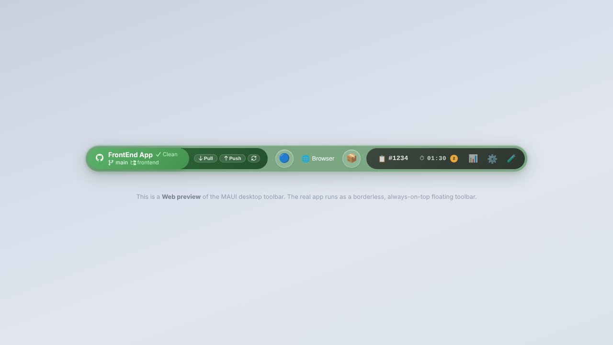
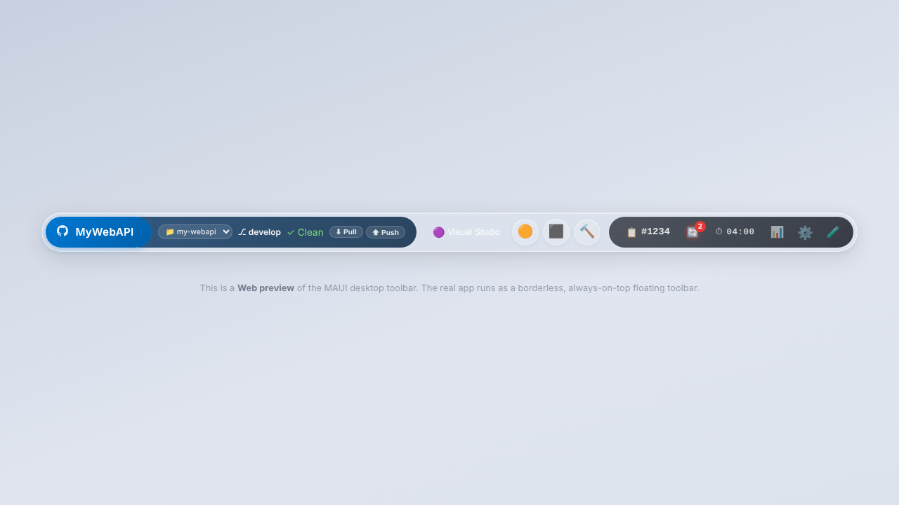
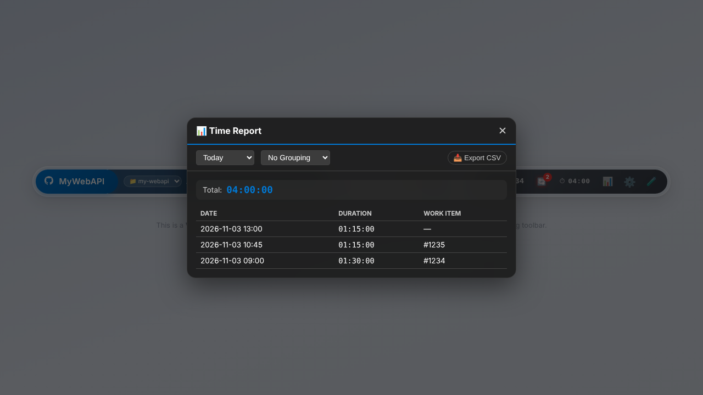
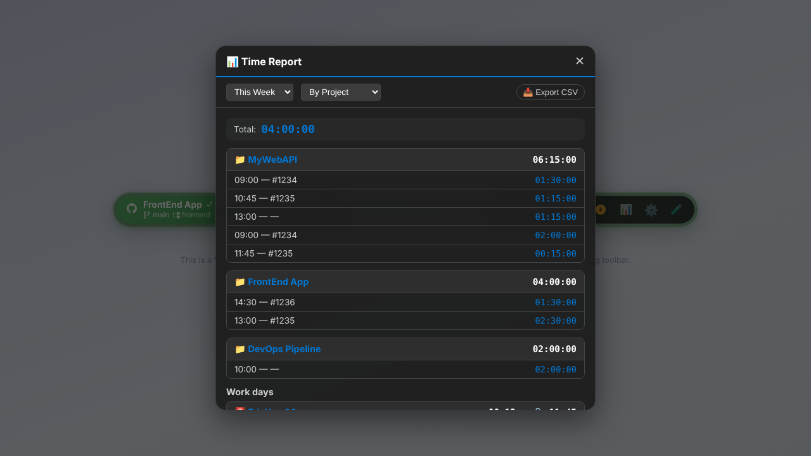
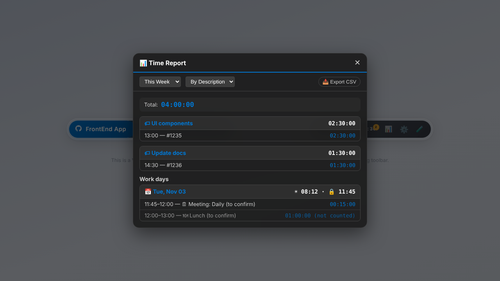
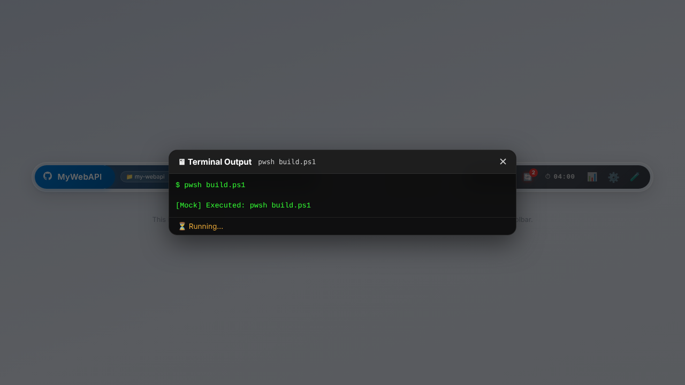
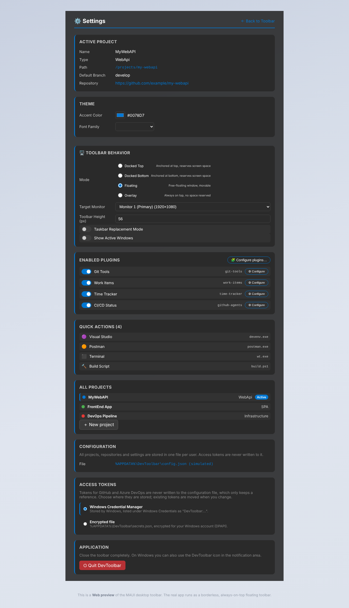
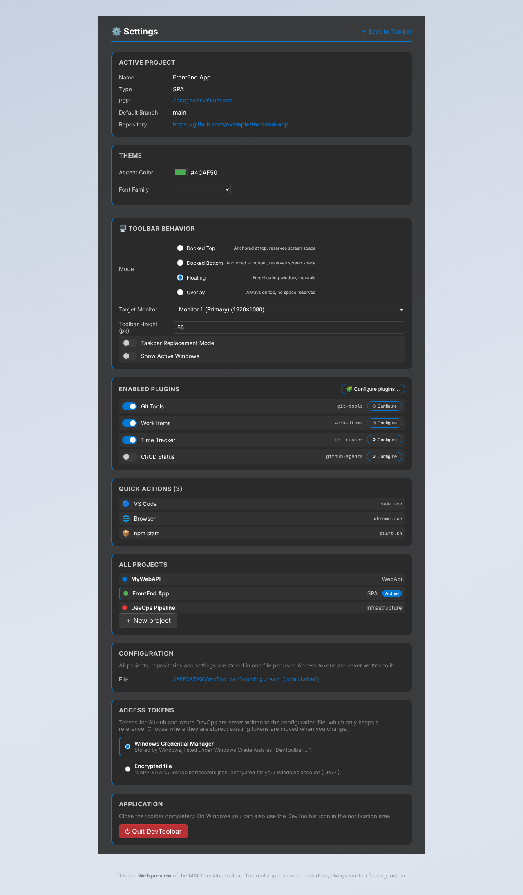
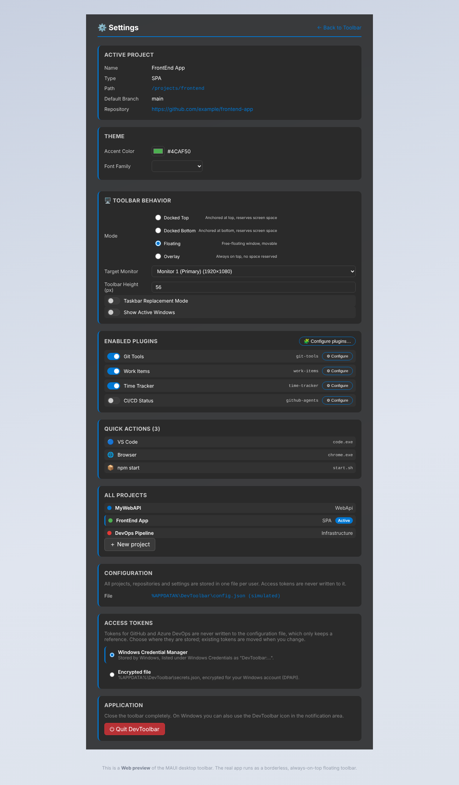
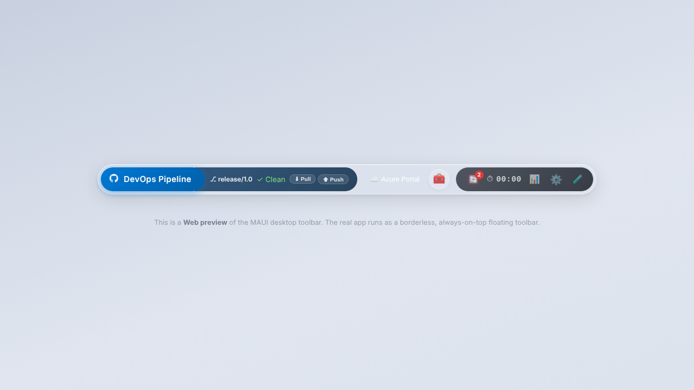

# DevToolbar

A small always-on-top developer toolbar for Windows, built with .NET 10 and Blazor. It shows the active project and its Git state, quick action buttons, plugin indicators (work items, time tracking, CI/CD) and a settings page.

This README describes **what the software does today**. The backlog (what it should do, with the status of every user story) is in [doc/Features.md](doc/Features.md), in French.

## Current status

| Area | Status |
|---|---|
| Windows host (WPF) | Works. Main Windows host. Still to be checked by hand on a PC: click-through, real mouse wheel, plugin configuration window. |
| Toolbar UI (project switch, actions, menus, settings, time report) | Works in every host. |
| Process and script actions, Smart Focus | Real in the Windows host. Script output appears when the script ends, not live. |
| Git plugin | Real in the Windows host: branch, changed files and ahead/behind are read from the repository's local folder (LibGit2Sharp, refreshed every 10 s); Pull/Push run the `git` CLI and show the real result (success, conflicts, Git error). |
| Work items, time tracking, CI/CD | **Simulated in every host**, including Windows. The UI works on sample data. |
| Configuration and storage | One file per user, `%APPDATA%\DevToolbar\config.json`, with a `schemaVersion`. Older files are migrated on start and the originals copied to `backups\`. A JSON `IStorageService` is available for plugin data; time entries and read states do not use it yet. |
| Access tokens | Stored outside the configuration, in Windows Credential Manager or a DPAPI-encrypted `secrets.json`, chosen in Settings. No provider uses tokens yet. |
| MAUI host | Frozen. Kept in the solution, no new features. |

## Projects

| Project | Type | Role |
|---|---|---|
| `src/DevToolbar.Core` | Class library | Interfaces, models, events. No UI or native dependency. |
| `src/DevToolbar.Infrastructure` | Class library | Real services for the desktop hosts: user configuration and migrations, JSON storage, Git (LibGit2Sharp), secret stores. |
| `src/DevToolbar.UI` | Razor class library | Blazor components, layout, pages, CSS, JS. |
| `src/DevToolbar.Plugins` | Class library | Built-in plugins: Git, Work Items, Time Tracker, CI/CD Status. |
| `src/DevToolbar.Windows` | WPF + Blazor Hybrid | **Main Windows host**: transparent, click-through toolbar window. |
| `src/DevToolbar.Web` | Blazor Web App | Test host with simulated services, used by the Playwright tests. |
| `src/DevToolbar.Maui` | MAUI Blazor Hybrid | Original Windows host, frozen. |
| `tests/DevToolbar.Tests.E2E` | NUnit + Playwright | UI tests against the Web host, and screenshot capture. |
| `tests/DevToolbar.Tests.Unit` | NUnit | Unit tests (Git plugin and real Git on temporary repositories, configuration and migrations, storage, secrets, host sizing). |

All projects target .NET 10. `spikes/window-feasibility/` keeps the experiment that led to the WPF host.

## Screenshots

Captured from the Web host by `ScreenshotTests`, so plugin data is sample data.

| | |
|---|---|
|  Main toolbar |  Pill layout |
|  Git plugin |  Quick actions |
|  Time report |  Time report grouped by project |
|  Time report grouped by description |  Script output |
|  Settings |  Settings, configuration section |
|  Settings, theme editor |  Switching project changes plugins, actions and accent color |

The visual direction for themes is [doc/Toolbar-desing-exemple.png](doc/Toolbar-desing-exemple.png).

## Features available today

- **Projects**: the left pill lists projects; switching updates plugins, actions and accent color. Settings → *New project* creates a project linked to a repository's local folder (*Browse…* opens the Windows folder dialog).
- **Git**: current branch, number of modified files and commits to push/pull, read from the folder; Pull/Push with their real result. Several repositories per project are possible, managed in the plugin configuration window.
- **Configuration file**: everything is in `%APPDATA%\DevToolbar\config.json` (shown in Settings). A file that cannot be read, or that was written by a newer version, is never overwritten.
- **Access tokens**: choose Windows Credential Manager or an encrypted file in Settings; switching moves the stored tokens.
- **Quick actions**: launch a program, focus its window if already open (Smart Focus), or run a `pwsh`/`cmd`/`python` script and see its output.
- **Plugin indicators**: work item, timer and CI/CD status in the system group, each with its own popover (sample data).
- **Time report**: today / 7 days / 30 days, grouped by project, work item, day or description, CSV export (sample data).
- **Theme**: accent color, font and custom CSS per project.
- **Window placement** (Windows host): docked top, docked bottom, floating or overlay, target monitor, drag handle.
- **Tray icon** (Windows host): left click shows or hides the toolbar; right click offers Settings and Quit. Closing the toolbar window quits the app.
- **Popups** close on outside click, on `Esc` (focus returns to the trigger) and when another application is activated.

## Getting started

### Prerequisites
- [.NET 10 SDK](https://dotnet.microsoft.com/)
- Windows with the WebView2 runtime, for the Windows host
- PowerShell, to install the Playwright browser

### Build
```bash
dotnet build DevToolbar.slnx
```
The MAUI and Windows projects only build on Windows (or on Linux with `-p:EnableWindowsTargeting=true` for `DevToolbar.Windows`).

### Run the Windows host
```powershell
dotnet run --project src/DevToolbar.Windows
```
The toolbar is a WPF layered window (`AllowsTransparency`) hosting the official WPF `BlazorWebView` (WebView2 composition control). Pixels with alpha 0 are click-through, so clicks and the mouse wheel reach the application under the empty areas around the pill and its menus. To keep that true, `src/DevToolbar.Windows/wwwroot/css/wpf-host.css` removes every outer `box-shadow`. Startup and crash diagnostics go to `%LOCALAPPDATA%\DevToolbar\logs\windows-host.log`. Pull and Push need Git on the `PATH`.

Files written for the current user, all in `%APPDATA%\DevToolbar`:

| File | Content |
|---|---|
| `config.json` | Settings, projects and repositories (`schemaVersion` 1). |
| `secrets.json` | Only when *Encrypted file* is the token store: values encrypted with DPAPI. |
| `data\*.json` | Plugin data, one file per namespace. |
| `backups\` | Copies taken before a migration, or of a file that could not be read. |

### Run the Web test host
```bash
dotnet run --project src/DevToolbar.Web
```
Then open `http://localhost:5028`. All services are simulated; nothing is launched on your machine.

### Run the tests
```bash
# First time: install the Playwright browser (the path depends on the build configuration)
dotnet build tests/DevToolbar.Tests.E2E
pwsh tests/DevToolbar.Tests.E2E/bin/Debug/net10.0/playwright.ps1 install chromium

dotnet test tests/DevToolbar.Tests.Unit
dotnet test tests/DevToolbar.Tests.E2E
```

### Refresh the screenshots
```bash
dotnet test tests/DevToolbar.Tests.E2E --filter "FullyQualifiedName~ScreenshotTests"
```
Screenshots are written to `doc/screenshots/`.

## Documentation

- [doc/Features.md](doc/Features.md): backlog, decisions, open questions and status of every user story (French).
- [spikes/window-feasibility/INTEGRATION.md](spikes/window-feasibility/INTEGRATION.md): why the Windows host is WPF, and the manual checks still to run on a PC (French).
