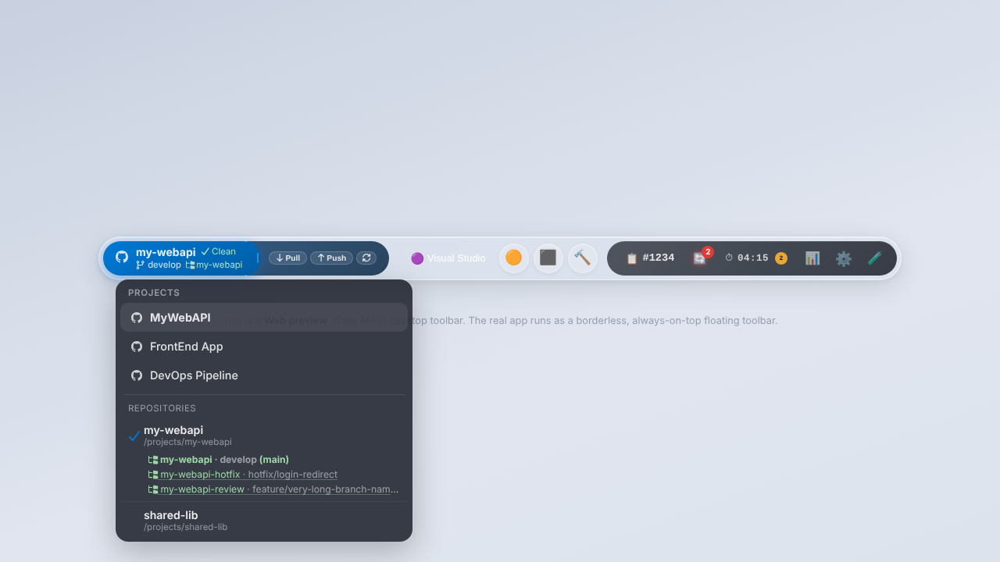
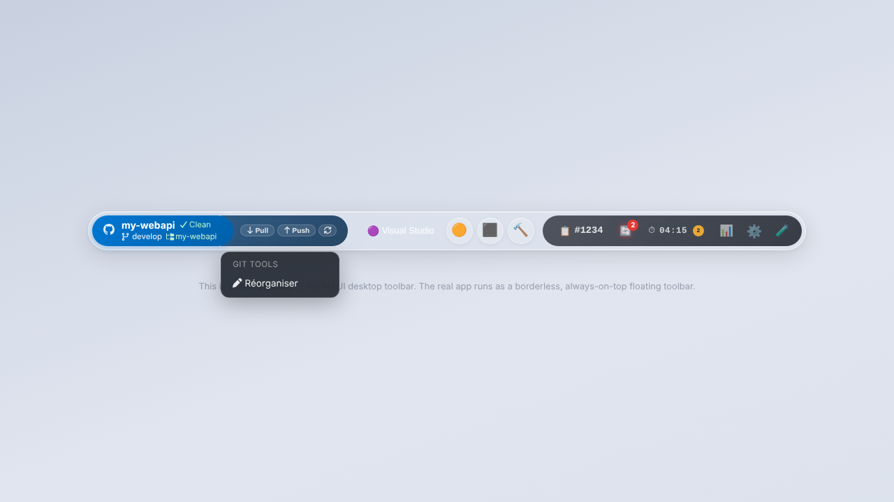
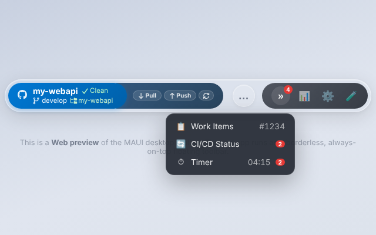

# Kazo Bar

A small always-on-top developer toolbar for Windows, built with .NET 10 and Blazor. It shows the active project and its Git state, quick action buttons, plugin indicators (work items, time tracking, CI/CD) and a settings page.

This README describes **what the software does today**. The backlog (what it should do, with the status of every user story) is in [doc/Features.md](doc/Features.md), in French.

## Current status

| Area | Status |
|---|---|
| Windows host (WPF) | Works. Main Windows host. Still to be checked by hand on a PC: click-through, real mouse wheel, plugin configuration window. |
| Toolbar UI (project switch, actions, menus, settings, time report) | Works in every host. |
| Process and script actions, Smart Focus | Real in the Windows host. Script output is shown line by line while the script runs, and can be stopped. |
| Git plugin | Real in the Windows host: branch, changed files and ahead/behind are read from the repository's local folder (LibGit2Sharp, refreshed every 10 s); Pull/Push run the `git` CLI and show the real result (success, conflicts, Git error). One selector for repositories and their worktrees (`git worktree list`). |
| Toolbar modules | Resizable modules (Git today) can be widened by dragging their right edge; a right click resets the width or moves the module left/right in its zone. Order and widths are saved in the configuration. Inside a narrow module, labels hide first. System zone modules that still do not fit move into a "»" menu that opens their panel. |
| Work items | Real in the Windows host: Azure DevOps (cloud) or GitHub Issues, configured per repository with a personal access token or an OAuth sign-in (GitHub, Microsoft). Simulated in the Web host. Not yet checked with real tokens on a PC. |
| CI/CD (GitHub Actions) | Real in the Windows host: workflow runs of each tracked repository are polled in the background (every 60 s by default) and the read state is saved. Agent sessions are not tracked yet (no public GitHub API). Simulated in the Web host. |
| Time tracking and work day | Real in the Windows host: the timer freezes on session lock, sleep or keyboard/mouse inactivity (15 min by default, global or per repository), and on return the absence is shown to be labelled (meeting, lunch, worked, other, removed). The lunch window and a daily meeting are recognised automatically. First activity and last lock of each day are recorded. Data in `%APPDATA%\Kazo\Bar\data\time-yyyy-MM.json`. The Web host uses a simulated sample day. |
| Configuration and storage | One file per user, `%APPDATA%\Kazo\Bar\config.json`, with a `schemaVersion`. Older files are migrated on start and the originals copied to `backups\`. Plugin data (time entries, GitHub Actions read states) goes through a JSON `IStorageService` in `data\`. |
| Access tokens | Stored outside the configuration, in Windows Credential Manager or a DPAPI-encrypted `secrets.json`, chosen in Settings. The work items and GitHub providers read their token from there. |
| MAUI host | Frozen. Kept in the solution, no new features. |

## Projects

| Project | Type | Role |
|---|---|---|
| `src/Kazo.Bar.Core` | Class library | Interfaces, models, events. No UI or native dependency. |
| `src/Kazo.Bar.Infrastructure` | Class library | Real services for the desktop hosts: user configuration and migrations, JSON storage, Git (LibGit2Sharp), secret stores, OAuth device flow, Azure DevOps and GitHub REST clients. |
| `src/Kazo.Bar.UI` | Razor class library | Blazor components, layout, pages, CSS, JS. |
| `src/Kazo.Bar.Plugins` | Class library | Built-in plugins: Git, Work Items, Time Tracker, CI/CD Status. To write your own, see [doc/Writing-a-plugin.md](doc/Writing-a-plugin.md). |
| `src/Kazo.Bar.Windows` | WPF + Blazor Hybrid | **Main Windows host**: transparent, click-through toolbar window. |
| `src/Kazo.Bar.Web` | Blazor Web App | Test host with simulated services, used by the Playwright tests. |
| `src/Kazo.Bar.Maui` | MAUI Blazor Hybrid | Original Windows host, frozen. |
| `tests/Kazo.Bar.Tests.E2E` | NUnit + Playwright | UI tests against the Web host, and screenshot capture. |
| `tests/Kazo.Bar.Tests.Unit` | NUnit | Unit tests (Git plugin and real Git on temporary repositories, configuration and migrations, storage, secrets, host sizing). |

All projects target .NET 10. `spikes/window-feasibility/` keeps the experiment that led to the WPF host.

## Screenshots

Captured from the Web host by `ScreenshotTests`, so plugin data is sample data.

| | |
|---|---|
|  Main toolbar |  Pill layout |
|  Git plugin |  Quick actions |
|  Time report |  Time report grouped by project |
|  Time report grouped by description |  Script output |
|  Settings |  Settings, configuration section |
|  Settings, theme editor |  Switching project changes plugins, actions and accent color |
|  Git module: repositories and worktrees |  Right-click menu of a module |
|  Modules that do not fit, in the "»" menu | |

The visual direction for themes is [doc/Toolbar-desing-exemple.png](doc/Toolbar-desing-exemple.png).

## Features available today

- **Projects**: the left pill lists projects; switching updates plugins, actions and accent color. Settings → *New project* creates a project linked to a repository's local folder (*Browse…* opens the Windows folder dialog).
- **Git**: the module shows the repository name first, then the branch and, when the repository has worktrees, the current worktree. Clicking it opens one menu listing the project's repositories, each with its worktrees as small links underneath; picking one makes status and Pull/Push run in that folder. Number of modified files and commits to push/pull are read from the folder. Repositories are managed in the plugin configuration window.
- **Project pill + Git**: the blue project pill shows the repository and its state, the branch and the worktree; its menu switches project, repository or worktree. The Git module glued to it holds Pull, Push and Pull & Push. Both stay on the left. Icons are Font Awesome Free SVGs (CC BY 4.0), embedded for offline use (`FaIcon`).
- **Toolbar layout**: drag the right edge of the project pill to widen it; right-click any module to reset its width or move it left/right, or choose **✏️ Réorganiser** to drag modules within and between the main and system zones (✅ keeps the new layout, ❎ or Esc cancels; the timer always stays last). Settings → *Toolbar Modules* lists the order and resets order or widths. Plugins opt in to resizing with `IPlugin.Layout => PluginLayout.ResizableWidth(default, min, max)`.
- **Configuration file**: everything is in `%APPDATA%\Kazo\Bar\config.json` (shown in Settings). A file that cannot be read, or that was written by a newer version, is never overwritten.
- **Access tokens**: choose Windows Credential Manager or an encrypted file in Settings; switching moves the stored tokens. A token typed in a plugin's settings is saved there and never shown again.
- **Sign in with GitHub / Microsoft**: instead of pasting a token, sign in with the OAuth device flow from the plugin settings. Register an OAuth app once per provider and paste its client ID in Settings → *Sign-in apps*; see [doc/Connexion-OAuth.md](doc/Connexion-OAuth.md) (French). Microsoft access tokens are renewed automatically.
- **Work items**: in the Work Items plugin settings, pick Azure DevOps (organization + project) or GitHub Issues (`owner/name`) for a repository and paste a token. The popover lists your open items, searches by title or number and links to the item on the web.
- **GitHub Actions**: in the GitHub plugin settings, turn on Actions tracking for a repository. The pill shows the overall state and the number of unread finished runs; opening a run marks it as read.
- **Quick actions**: launch a program, or focus its window if already open (Smart Focus; when several windows match, a menu lets you pick one). Run a `pwsh`/`cmd`/`python` script and watch its output live, with a Stop button.
- **Debug tools**: the 🧪 test dropdown only appears in Debug builds.
- **Plugin indicators**: work item and CI/CD status in the system group, each with its own popover.
- **Timer** (Windows host): Start/Stop on the active project and work item; paused while you are away, then resumed. The ⏱ panel shows when you arrived, your last lock, and the absences to label; a badge on the timer counts them. Rules in Settings → *Time tracking*.
- **Time report**: today / 7 days / 30 days, grouped by project, work item, day or description, CSV export, plus each work day with its arrival, last lock and absences.
- **Theme**: light, dark or green toolbar theme (from the design mockup), accent color, font and custom CSS, per project.
- **Window placement** (Windows host): docked top, docked bottom, floating or overlay, target monitor, drag handle.
- **Tray icon** (Windows host): left click shows or hides the toolbar; right click offers Settings and Quit. Closing the toolbar window quits the app.
- **Popups** close on outside click, on `Esc` (focus returns to the trigger) and when another application is activated.

## Getting started

### Prerequisites
- [.NET 10 SDK](https://dotnet.microsoft.com/)
- Windows with the WebView2 runtime, for the Windows host
- PowerShell, to install the Playwright browser

### Build
```bash
dotnet build Kazo.Bar.slnx
```
The MAUI and Windows projects only build on Windows (or on Linux with `-p:EnableWindowsTargeting=true` for `Kazo.Bar.Windows`).

### Run the Windows host
```powershell
dotnet run --project src/Kazo.Bar.Windows
```
The toolbar is a WPF layered window (`AllowsTransparency`) hosting the official WPF `BlazorWebView` (WebView2 composition control). Pixels with alpha 0 are click-through, so clicks and the mouse wheel reach the application under the empty areas around the pill and its menus. To keep that true, `src/Kazo.Bar.Windows/wwwroot/css/wpf-host.css` removes every outer `box-shadow`. Startup and crash diagnostics go to `%LOCALAPPDATA%\Kazo\Bar\logs\windows-host.log`. Pull and Push need Git on the `PATH`.

Files written for the current user, all in `%APPDATA%\Kazo\Bar`:

| File | Content |
|---|---|
| `config.json` | Settings, projects and repositories (`schemaVersion` 1). |
| `secrets.json` | Only when *Encrypted file* is the token store: values encrypted with DPAPI. |
| `data\*.json` | Plugin data, one file per namespace. |
| `backups\` | Copies taken before a migration, or of a file that could not be read. |

Upgrading from the DevToolbar name: on first start, the Windows host copies `%APPDATA%\DevToolbar` to `%APPDATA%\Kazo\Bar` (only when the new folder is empty), then leaves `migrated-to-kazo-bar.txt` in the old folder, which is kept as a backup. Credential Manager secrets move from `DevToolbar:<ref>` to `Kazo.Bar:<ref>`. The frozen MAUI host still uses `%APPDATA%\DevToolbar`.

### Run the Web test host
```bash
dotnet run --project src/Kazo.Bar.Web
```
Then open `http://localhost:5028`. All services are simulated; nothing is launched on your machine.

### Run the tests
```bash
# First time: install the Playwright browser (the path depends on the build configuration)
dotnet build tests/Kazo.Bar.Tests.E2E
pwsh tests/Kazo.Bar.Tests.E2E/bin/Debug/net10.0/playwright.ps1 install chromium

dotnet test tests/Kazo.Bar.Tests.Unit
dotnet test tests/Kazo.Bar.Tests.E2E
```

### Refresh the screenshots
```bash
dotnet test tests/Kazo.Bar.Tests.E2E --filter "FullyQualifiedName~ScreenshotTests"
```
Screenshots are written to `doc/screenshots/`.

## Documentation

- [doc/Naming.md](doc/Naming.md): confirmed Kazo Bar naming conventions and proposals still to decide (French).
- [doc/Features.md](doc/Features.md): backlog, decisions, open questions and status of every user story (French).
- [doc/Connexion-OAuth.md](doc/Connexion-OAuth.md): registering the GitHub and Microsoft apps behind the "Sign in" buttons (French).
- [spikes/window-feasibility/INTEGRATION.md](spikes/window-feasibility/INTEGRATION.md): why the Windows host is WPF, and the manual checks still to run on a PC (French).
