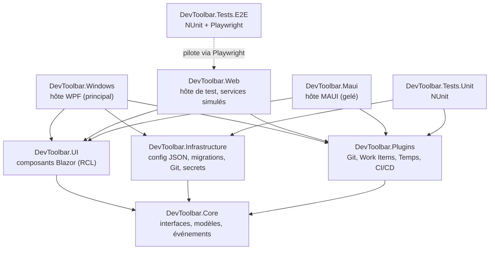

# DevToolbar : backlog des fonctionnalités

Ce document est le **backlog** du projet : il décrit ce que la toolbar doit faire, et indique pour chaque user story ce qui est déjà fait. L'état actuel du logiciel, pour un nouvel utilisateur, est décrit dans le [README](../README.md) (en anglais).

Dernière revue complète contre le code : 3 novembre 2026 (branche `main`, après les PR #2 à #7). Mise à jour le même jour pour les fondations : configuration unique, migrations, Git réel, secrets.

## Comment lire ce document

**État d'une user story** (colonne « État » et ligne en tête de chaque US) :

| Symbole | Signification |
|---|---|
| ✅ Fait | Tous les critères d'acceptation sont remplis dans l'hôte WPF. |
| 🟡 Partiel | Une partie des critères est remplie ; les cases non cochées disent ce qui manque. |
| 🎭 Simulé | L'interface est faite, mais les données viennent d'un service simulé (mock), **y compris dans l'hôte WPF**. |
| ⬜ À faire | Rien n'est implémenté. |
| 🔍 À recetter | Implémenté, mais pas encore vérifié à la main sur un PC Windows. |
| 🧊 Gelé | Conservé, mais ne reçoit plus de nouvelles fonctions. |

**Critères d'acceptation** : `- [x]` = fait, `- [ ]` = pas fait.

## Vocabulaire

| Terme | Sens dans ce document |
|---|---|
| **Projet** | Un contexte de travail sélectionnable dans la toolbar (pilule de gauche). On le crée puis on l'associe à un dépôt et à son dossier local. Il porte aussi des actions et un thème. |
| **Dépôt** | Un dépôt Git configuré dans un projet. Chaque dépôt est **relié à un dossier local**. Les fournisseurs (work items, CI/CD, sessions d'agents) se configurent par dépôt. |
| **Hôte** | L'exécutable qui affiche l'interface Blazor : WPF (principal), Web (tests), MAUI (gelé). |
| **Plugin** | Un module qui ajoute un indicateur et un panneau à la toolbar (Git, Work Items, Temps, CI/CD). |
| **Pilule** | La forme arrondie de la toolbar et de ses groupes, voir la maquette. |
| **Configuration utilisateur** | Le fichier JSON unique de l'utilisateur, dans `%APPDATA%\DevToolbar`, qui contient tous les projets et dépôts. |

## Décisions prises

| Sujet | Décision | Date |
|---|---|---|
| Hôte Windows | WPF (`src/DevToolbar.Windows`) est la voie principale. MAUI est **gelé** : il reste dans la solution mais ne reçoit plus de nouvelles fonctions. | 2 et 3 nov. 2026 |
| Configuration | **Un seul fichier de configuration par utilisateur**, qui contient tous les projets et dépôts. Pas de niveaux Global / Type / Projet, pas de `template.json`. | 3 nov. 2026 |
| Données sensibles | Les jetons ne vont **pas** dans le JSON en clair. On offre **deux options** : le coffre du système (Gestionnaire d'identification Windows) ou un fichier chiffré localement. | 3 nov. 2026 |
| Authentification | On suit la méthode **recommandée par chaque fournisseur** (OAuth en général). Le PAT reste possible pour démarrer. | 3 nov. 2026 |
| Projet et dépôt | On crée un projet et on l'associe à un dépôt et à son dossier local. Le modèle permet plusieurs dépôts par projet, mais la gestion de plusieurs dépôts est un **ajout pour plus tard** : la priorité est le cas un projet = un dépôt. | 3 nov. 2026 |
| Stockage | Fichiers JSON dans `%APPDATA%\DevToolbar` pour l'instant. Chaque fichier porte une propriété de **version de schéma** et doit pouvoir être migré (vers un autre format ou une base plus tard). SQLite n'est plus requis. | 3 nov. 2026 |
| Work items | Configurables **par dépôt** : Azure DevOps (cloud) et GitHub Issues. Authentification par PAT pour commencer. | 3 nov. 2026 |
| Suivi GitHub (F7) | Configurable **par dépôt** : workflows GitHub Actions, sessions d'agents, ou les deux. | 3 nov. 2026 |
| Git | État lu dans le dossier local du dépôt avec **LibGit2Sharp** (pas de la configuration). | 3 nov. 2026 |
| Maquette | `doc/Toolbar-desing-exemple.png` est une **ligne directrice** : les éléments restent les mêmes, les thèmes proposés à l'utilisateur changent le style. | 3 nov. 2026 |
| Fonctions de debug | Visibles uniquement dans une build `Debug` (`#if DEBUG` ou `IsDevelopment`). Seul le bouton 🧪 « Test Dropdown » est concerné. Les modes d'ancrage, l'écran cible, la hauteur, les fenêtres actives et le remplacement de la barre des tâches sont des fonctions normales. | 3 nov. 2026 |
| Plugins tiers | Pas de chargement de DLL externes pour l'instant, mais le système de plugins doit rester ouvert pour que n'importe qui puisse en écrire un. | 3 nov. 2026 |
| Intégration continue | Pas maintenant ; obligatoire pour la version finale. | 3 nov. 2026 |
| Fermer la toolbar | Fermer la fenêtre **quitte l'application** (pas de réduction dans la zone de notification). | 3 nov. 2026 |

## Questions ouvertes

Aucune pour l'instant. Les nouvelles questions s'ajoutent ici avec un numéro.

## Vue d'ensemble

| US | Titre | État |
|---|---|---|
| US1.1 | Solution et projets | ✅ |
| US1.2 | Interfaces Core | ✅ |
| US2.1 | Système de plugins | 🟡 |
| US2.2 | Changement de projet | ✅ |
| US2.3 | Configuration utilisateur unique | 🟡 🔍 |
| US2.4 | Stockage sécurisé des secrets | 🟡 🔍 |
| US2.5 | Version de schéma et migration | ✅ 🔍 |
| US3.1 | Layout principal (pilule) | ✅ |
| US3.2 | Couleur d'accent et police par projet | ✅ |
| US3.3 | Thèmes proposés à l'utilisateur | 🟡 |
| US3.4 | Vue compacte et débordement | ⬜ |
| US3.5 | Fonctions de debug masquées en Release | ⬜ |
| US4.1 | Bouton « Lancer processus » | ✅ |
| US4.2 | Smart Focus | 🟡 |
| US4.3 | Bouton script et sortie terminal | 🟡 |
| US5.1 | Plugin Git | ✅ 🔍 |
| US5.2 | Plugin Work Items | 🎭 |
| US5.3 | Suivi du temps et inactivité | 🎭 |
| US5.4 | Rapports de temps | 🎭 |
| US5.5 | Journée de travail (arrivée, dîner, réunion) | ⬜ |
| US6.1 | Tests Playwright sur l'hôte Web | ✅ |
| US6.2 | Intégration continue | ⬜ |
| US7.1 | Suivi GitHub en arrière-plan | 🎭 |
| US7.2 | Consultation et « marquer comme lu » | 🎭 |
| US8.1 | Fenêtre native | ✅ 🔍 |
| US8.2 | Zone de notification | ✅ 🔍 |
| US8.3 | Stockage local JSON | 🟡 🔍 |
| US8.4 | Position et ancrage de la toolbar | ✅ 🔍 |
| US8.5 | Barre des tâches et fenêtres actives | 🟡 |
| US9.1 | Hôte WPF principal | ✅ 🔍 |
| US9.2 | Hôte MAUI gelé | 🧊 |
| US10.1 | Sessions et coûts IA (v2) | ⬜ v2 |
| US10.2 | Rapport des coûts IA (v2) | ⬜ v2 |

---

# F1. Architecture et fondations

## Projets de la solution



```text
DevToolbar.slnx
├── src
│   ├── DevToolbar.Core       Interfaces/, Models/, Events/, Layout/, Configuration/, Data/
│   ├── DevToolbar.Infrastructure  Storage/, Configuration/, Git/, Secrets/ (services réels, testés sous Linux)
│   ├── DevToolbar.UI         Components/, Layouts/, Pages/, Services/, wwwroot/
│   ├── DevToolbar.Plugins    Git/, WorkItems/, TimeTracker/, GithubAgents/, Services/PluginLoader.cs
│   ├── DevToolbar.Windows    Hôte WPF : ToolbarWindow.cs, Program.cs, Services/
│   ├── DevToolbar.Web        Hôte de test : Mocks/, Program.cs
│   └── DevToolbar.Maui       Hôte MAUI gelé
├── tests
│   ├── DevToolbar.Tests.E2E  Drivers/, Scenarios/
│   └── DevToolbar.Tests.Unit
└── spikes/window-feasibility Banc d'essai de la fenêtre transparente (historique)
```

Tous les projets ciblent **.NET 10**.

## US1.1 Solution et projets
**État :** ✅ Fait

**En tant que** développeur
**Je veux** une solution qui sépare la logique, l'interface et les hôtes natifs
**Afin de** réutiliser la même interface dans plusieurs hôtes et la tester dans un navigateur.

**Critères d'acceptation :**
- [x] La solution `DevToolbar.slnx` contient Core, Infrastructure, UI, Plugins, Windows, Web, Maui et les deux projets de tests.
- [x] `DevToolbar.UI` et `DevToolbar.Plugins` ne référencent que `DevToolbar.Core`.
- [x] Chaque hôte référence UI, Plugins et Core.
- [x] L'hôte Web démarre et affiche la toolbar sans erreur.

## US1.2 Interfaces Core
**État :** ✅ Fait

**En tant qu'** architecte
**Je veux** que tout accès natif (processus, fichiers, fenêtres, configuration, stockage) passe par une interface de `DevToolbar.Core`
**Afin d'** injecter des services réels dans l'hôte WPF et des services simulés dans l'hôte Web.

**Critères d'acceptation :**
- [x] Interfaces dans `src/DevToolbar.Core/Interfaces/` : `IProcessService`, `IFileSystemService`, `ISettingsService`, `IGlobalSettingsService`, `IScriptService`, `IStorageService`, `IPlugin`, `IPluginLoader`, `IWorkItemProvider`, `ITimeTrackingService`, `ICiCdService`, et les services de fenêtre (`IDockingService`, `IWindowService`, `IWindowDragService`, `IHostSurfaceService`, `IWindowRegionService`, `INativeService`).
- [x] L'hôte Web n'enregistre que des implémentations simulées (`src/DevToolbar.Web/Mocks/`).

```csharp
public interface IProcessService
{
    Task<int> StartProcessAsync(string path, string arguments = "");
    bool FocusWindowByTitle(string titleRegex);
}
```

---

# F2. Plugins et configuration

## US2.1 Système de plugins
**État :** 🟡 Partiel

**En tant que** développeur tiers
**Je veux** écrire mon propre plugin en implémentant `IPlugin`
**Afin d'** ajouter à la toolbar un outil adapté à mes besoins.

**Critères d'acceptation :**
- [x] `PluginLoader` (`src/DevToolbar.Plugins/Services/PluginLoader.cs`) liste les plugins enregistrés dans l'injection de dépendances.
- [x] Chaque plugin a un `UniqueId`, un `Name` et une icône.
- [x] Un plugin peut afficher un indicateur dans la pilule (`IPluginIndicator`) et une fenêtre de configuration (`IConfigurablePlugin`).
- [ ] Un guide « Écrire un plugin » explique le contrat et comment l'enregistrer.
- Hors périmètre pour l'instant : chargement de DLL externes depuis un dossier.

## US2.2 Changement de projet
**État :** ✅ Fait

**En tant qu'** utilisateur
**Je veux** que la toolbar change quand je sélectionne un autre projet
**Afin de** voir uniquement les outils utiles à ce projet.

**Critères d'acceptation :**
- [x] Le sélecteur de projet (pilule de gauche) liste les projets de la configuration.
- [x] Le changement de projet notifie tous les plugins (`OnProjectChangedAsync`) et met à jour les actions et le thème.
- [x] Seuls les plugins de `enabledPlugins` sont affichés.

## US2.3 Configuration utilisateur unique
**État :** 🟡 Partiel, 🔍 à recetter sur PC

**En tant qu'** utilisateur
**Je veux** que toute ma configuration (projets, dépôts, actions, thèmes, règles de temps) soit dans un seul fichier
**Afin de** savoir où elle se trouve et de pouvoir la sauvegarder facilement.

**Critères d'acceptation :**
- [x] La configuration est lue depuis `%APPDATA%\DevToolbar\config.json` (`UserConfigurationStore`, `src/DevToolbar.Infrastructure/Configuration/`).
- [x] Un seul fichier contient tout : `settings` (réglages globaux) et `projects`. L'ancien `global-settings.json` est fusionné au premier lancement puis déplacé dans `backups\`.
- [x] Les surcharges par `.devtoolbar.json` dans le dossier du projet sont **retirées** de l'hôte WPF (l'hôte MAUI gelé garde son ancien code).
- [x] Chaque dépôt déclare son dossier local (`localPath`).
- [ ] Chaque dépôt déclare son fournisseur de work items et son suivi GitHub (avec les fournisseurs réels, US5.2 et US7.1).
- [x] Aucune donnée sensible n'est écrite dans ce fichier : les jetons vont dans le magasin de secrets (US2.4).
- [x] Paramètres affiche l'emplacement du fichier (section « Configuration »).

Forme actuelle (schéma 1). Les blocs `workItems`, `github` et `timeTracking` d'un dépôt arriveront avec les fournisseurs et le suivi du temps :

```json
{
  "schemaVersion": 1,
  "activeProjectId": "alpha",
  "settings": { "toolbarBehavior": 2, "targetMonitorIndex": 0, "toolbarHeight": 56, "secretStore": "CredentialManager" },
  "projects": [
    {
      "id": "alpha",
      "name": "Projet Alpha",
      "theme": { "name": "light", "accentColor": "#0078D7" },
      "enabledPlugins": ["git", "work-items", "time-tracker", "github-agents"],
      "actions": [],
      "repositories": [
        {
          "name": "alpha-api",
          "localPath": "C:\\repos\\alpha-api",
          "remoteUrl": "https://github.com/contoso/alpha-api.git",
          "defaultBranch": "main",
          "workItems": { "provider": "AzureDevOps", "organization": "contoso", "project": "Alpha", "secretRef": "alpha-devops-pat" },
          "github": { "repository": "contoso/alpha-api", "trackActions": true, "trackAgentSessions": false, "secretRef": "alpha-github-pat" },
          "timeTracking": { "idleMinutes": 10 }
        }
      ]
    }
  ]
}
```

## US2.4 Stockage sécurisé des secrets
**État :** 🟡 Partiel, 🔍 à recetter sur PC

**En tant qu'** utilisateur
**Je veux** que mes jetons d'accès soient stockés de façon chiffrée
**Afin qu'** une copie de mon fichier de configuration ne donne pas accès à mes comptes.

**Critères d'acceptation :**
- [x] Les secrets sont rangés sous une référence (`secretRef`) via `ISecretStore` ; la configuration ne garde que la référence. *(Les fournisseurs qui écriront ces références arrivent avec US5.2 et US7.1.)*
- [x] L'utilisateur choisit où sont stockés ses secrets dans Paramètres (« Access tokens ») : Gestionnaire d'identification Windows (`DevToolbar:<ref>`), ou `%APPDATA%\DevToolbar\secrets.json` chiffré par DPAPI pour son compte Windows. Changer de choix déplace les secrets existants.
- [ ] Chaque fournisseur utilise la méthode d'authentification qu'il recommande (OAuth pour GitHub et Azure DevOps) ; le PAT reste possible pour démarrer.
- [ ] Les jetons saisis dans Paramètres ne sont jamais réaffichés en clair (champ de saisie à venir avec les fournisseurs).
- [ ] Recette sur PC : écriture, lecture et suppression dans le Gestionnaire d'identification et avec DPAPI (non testables dans le conteneur Linux).

## US2.5 Version de schéma et migration
**État :** ✅ Fait, 🔍 à recetter sur PC (migration d'une vraie configuration existante)

**En tant que** mainteneur
**Je veux** que chaque fichier de données porte sa version de schéma
**Afin de** faire évoluer le format sans perdre les données des utilisateurs.

**Critères d'acceptation :**
- [x] Chaque fichier JSON écrit par l'application contient `schemaVersion` (`config.json`, `secrets.json`, `data\*.json`).
- [x] Au chargement, un fichier d'ancienne version est migré puis réécrit ; une copie de l'original est conservée dans `%APPDATA%\DevToolbar\backups\` (`config.v0.<date>.json`). Les migrations travaillent sur l'arbre JSON (`IJsonMigration`, `VersionedJson`).
- [x] Un fichier illisible ou écrit par une version plus récente n'est jamais écrasé : l'application démarre sur des valeurs par défaut et le signale dans le journal.
- [x] L'accès aux données passe par `IStorageService`, pour pouvoir changer de format (base de données) plus tard.

---

# F3. Interface et thèmes

Référence visuelle : [`doc/Toolbar-desing-exemple.png`](Toolbar-desing-exemple.png). C'est une ligne directrice : la disposition et les éléments sont fixes, les thèmes en changent le style.

## US3.1 Layout principal (pilule)
**État :** ✅ Fait

**En tant qu'** utilisateur
**Je veux** une toolbar compacte en forme de pilule
**Afin d'** accéder à mes outils sans perdre de place à l'écran.

**Critères d'acceptation :**
- [x] De gauche à droite : projet et Git, actions rapides, puis groupe système (indicateurs des plugins, temps, rapports, paramètres).
- [x] `ProjectSelector`, `PluginZone`, `ActionDeck` et la poignée de déplacement sont des composants de `DevToolbar.UI`.
- [x] Les menus s'ouvrent sous la toolbar, ou au-dessus si elle est ancrée en bas.
- [x] Les menus se ferment par un clic extérieur, `Échap` (le focus revient au déclencheur) ou quand une autre application est activée.

## US3.2 Couleur d'accent et police par projet
**État :** ✅ Fait

**En tant qu'** utilisateur
**Je veux** que la couleur d'accent change selon le projet
**Afin de** savoir d'un coup d'œil dans quel contexte je suis.

**Critères d'acceptation :**
- [x] `ThemeService` génère les variables CSS `--accent-color` et `--font-family`.
- [x] Un CSS personnalisé dans la configuration du projet est injecté.
- [x] La couleur et la police se modifient dans Paramètres.

## US3.3 Thèmes proposés à l'utilisateur
**État :** 🟡 Partiel

**En tant qu'** utilisateur
**Je veux** choisir un thème (clair, sombre, vert…)
**Afin d'** adapter la toolbar à mon goût sans changer sa disposition.

**Critères d'acceptation :**
- [ ] Les thèmes clair, sombre et vert de la maquette sont disponibles dans l'interface Blazor.
- [ ] Le thème se choisit dans Paramètres.
- [ ] Un thème ne change que les styles (couleurs, ombres intérieures, rayons), jamais les éléments.

## US3.4 Vue compacte et débordement
**État :** ⬜ À faire

**En tant qu'** utilisateur avec peu de place
**Je veux** que les textes longs soient tronqués et que les actions en trop passent dans un menu « … »
**Afin que** la toolbar reste lisible.

**Critères d'acceptation :**
- [ ] Le nom de projet et la branche sont tronqués avec « … » et affichés en entier dans l'info-bulle.
- [ ] Quand les actions ne tiennent pas, un bouton « … » ouvre un menu avec les actions masquées.

## US3.5 Fonctions de debug masquées en Release
**État :** ⬜ À faire

**En tant qu'** utilisateur final
**Je veux** ne pas voir les outils de développement de la toolbar
**Afin d'** avoir une interface propre.

**Critères d'acceptation :**
- [ ] Le bouton 🧪 « Test Dropdown » n'est rendu que dans une build `Debug` (`#if DEBUG`) ou en environnement de développement.
- [ ] Toute future fonction de debug suit la même règle.

---

# F4. Actions rapides

## US4.1 Bouton « Lancer processus »
**État :** ✅ Fait

**En tant que** développeur
**Je veux** un bouton qui lance un programme (Postman, Visual Studio…)
**Afin de** gagner du temps.

**Critères d'acceptation :**
- [x] Configuration : icône, libellé, chemin, arguments.
- [x] Lancement via `IProcessService.StartProcessAsync`.
- [x] Notification d'erreur si le chemin est invalide.

## US4.2 Smart Focus
**État :** 🟡 Partiel

**En tant qu'** utilisateur
**Je veux** qu'un bouton active la fenêtre de l'application si elle est déjà ouverte, et la lance sinon
**Afin de** ne pas ouvrir dix fois la même application.

**Critères d'acceptation :**
- [x] Configuration : expression régulière sur le titre de la fenêtre (`windowTitleRegex`).
- [x] Fenêtre trouvée : elle passe au premier plan. Sinon : le programme est lancé.
- [ ] Plusieurs fenêtres trouvées : un menu permet de choisir laquelle activer.

## US4.3 Bouton script et sortie terminal
**État :** 🟡 Partiel

**En tant que** DevOps
**Je veux** lancer un script et voir sa sortie
**Afin de** vérifier qu'il a réussi.

**Critères d'acceptation :**
- [x] Choix de l'interpréteur (`pwsh`, `cmd`, `python`).
- [x] Une fenêtre « Terminal Output » affiche la sortie et le code de retour.
- [ ] La sortie s'affiche **ligne par ligne pendant l'exécution** (aujourd'hui elle n'apparaît qu'à la fin).

---

# F5. Plugins fournis

## US5.1 Plugin Git
**État :** ✅ Fait, 🔍 à recetter sur PC

**En tant que** développeur
**Je veux** voir la branche courante et l'état de mes dépôts
**Afin de** ne pas commiter dans la mauvaise branche.

**Critères d'acceptation :**
- [x] À la création d'un projet (Paramètres, « ＋ New project »), on l'associe à un dépôt et à son dossier local (cas principal).
- [x] *(Ajout pour plus tard, déjà amorcé par la PR #4)* Un projet peut contenir plusieurs dépôts ; on en sélectionne un dans le panneau Git.
- [x] Boutons Pull et Push sur le dépôt sélectionné (CLI `git`).
- [x] Les dépôts se gèrent dans la fenêtre de configuration du plugin.
- [x] Chaque dépôt est relié à un dossier local, choisi à la configuration (bouton « Browse… » / 📂, boîte de dialogue Windows).
- [x] La branche, le nombre de fichiers modifiés et l'avance/retard sur la branche suivie sont **lus dans le dossier local** avec LibGit2Sharp (`GitService`), relus toutes les 10 secondes. Dossier absent ou non Git : la toolbar l'indique.
- [x] Pull et Push (CLI `git`, sans invite de mot de passe, délai de 2 minutes) affichent leur résultat réel (succès, conflit, erreur de Git).

## US5.2 Plugin Work Items
**État :** 🎭 Simulé (`MockWorkItemProvider` dans tous les hôtes)

**En tant que** développeur
**Je veux** voir le ticket sur lequel je travaille et en changer
**Afin d'** imputer mon temps au bon ticket.

**Critères d'acceptation :**
- [x] Affichage « #ID - Titre », recherche et sélection d'un autre ticket.
- [x] Interface `IWorkItemProvider` commune aux fournisseurs.
- [ ] Fournisseur **Azure DevOps (cloud)**.
- [ ] Fournisseur **GitHub Issues**.
- [ ] Authentification recommandée par le fournisseur (OAuth), PAT possible pour démarrer (voir US2.4).
- [ ] Le fournisseur se configure **par dépôt**.
- [ ] Lien cliquable vers le ticket sur le web.

## US5.3 Suivi du temps et inactivité
**État :** 🎭 Simulé (`MockTimeTrackingService` dans tous les hôtes)

**En tant qu'** employé ou travailleur autonome
**Je veux** que le temps soit suivi automatiquement et que mes absences soient détectées
**Afin d'** avoir des feuilles de temps exactes.

**Critères d'acceptation :**
- [x] Démarrer / arrêter le timer, total du jour affiché dans la pilule.
- [x] Le temps est rattaché au projet et au ticket actif.
- [ ] Le verrouillage de session Windows (`SystemEvents.SessionSwitch`) et l'inactivité clavier/souris sont détectés.
- [ ] Le délai d'inactivité est configurable **globalement** et **par dépôt** (le réglage du dépôt l'emporte). Défaut : 15 minutes.
- [ ] Au retour, la toolbar affiche la durée de l'absence et permet de la qualifier : réunion, dîner, autre (texte libre), ou à retirer.
- [ ] Les entrées sont enregistrées localement (voir US8.3).

## US5.4 Rapports de temps
**État :** 🎭 Simulé (affiche les données du service simulé)

**En tant qu'** utilisateur
**Je veux** consulter le temps passé par projet et par ticket
**Afin de** remplir mes feuilles de temps ou facturer.

**Critères d'acceptation :**
- [x] Fenêtre de rapport ouverte depuis le groupe système.
- [x] Période : aujourd'hui, 7 derniers jours, 30 derniers jours.
- [x] Regroupement par projet, ticket, jour ou description.
- [x] Export CSV.
- [ ] Les absences qualifiées (réunion, dîner) apparaissent dans le rapport.

## US5.5 Journée de travail (arrivée, dîner, réunion)
**État :** ⬜ À faire

**En tant qu'** employé
**Je veux** voir à quelle heure j'ai ouvert ma session le matin et à quelle heure je l'ai verrouillée le soir, et que le dîner et ma réunion quotidienne soient reconnus automatiquement
**Afin de** remplir ma feuille de temps sans tout ressaisir.

**Critères d'acceptation :**
- [ ] L'heure de première ouverture de session et l'heure du dernier verrouillage de la journée sont enregistrées et affichées.
- [ ] Une absence d'environ une heure **entre 12 h et 13 h** est comptée automatiquement comme dîner.
- [ ] L'utilisateur peut indiquer qu'il a travaillé pendant le dîner ; le temps est alors compté comme travaillé.
- [ ] Une réunion quotidienne récurrente se configure (par exemple 11 h 45 à 12 h). Exemple : une absence de 11 h 45 à 13 h devient réunion (11 h 45 à 12 h) puis dîner (12 h à 13 h).
- [ ] Les plages du dîner et de la réunion se configurent globalement et par dépôt.

---

# F6. Tests et qualité

## US6.1 Tests Playwright sur l'hôte Web
**État :** ✅ Fait

**En tant que** développeur
**Je veux** tester l'interface de la toolbar dans un navigateur
**Afin de** valider l'interface sans lancer Windows.

**Critères d'acceptation :**
- [x] `DevToolbar.Web` utilise uniquement des services simulés (aucun processus réel n'est lancé).
- [x] `DevToolbar.Tests.E2E` démarre l'hôte Web et vérifie chaque US visible (`FeatureSpecTests`, `ToolbarUiTests`, `PluginSettingsTests`).
- [x] `ScreenshotTests` régénère les captures de `doc/screenshots/`.
- [x] `DevToolbar.Tests.Unit` couvre le plugin Git, la négociation de taille de l'hôte, la configuration et ses migrations, le stockage JSON, Git réel (dépôts temporaires) et les secrets.

## US6.2 Intégration continue
**État :** ⬜ À faire, obligatoire pour la version finale

**Critères d'acceptation :**
- [ ] Un workflow GitHub Actions compile la solution et lance les tests unitaires et Playwright à chaque PR.

---

# F7. Suivi GitHub : Actions et sessions d'agents

Le suivi se configure **par dépôt** : workflows GitHub Actions, sessions d'agents, ou les deux.

## US7.1 Suivi en arrière-plan
**État :** 🎭 Simulé (`MockCiCdService` dans tous les hôtes)

**En tant que** développeur
**Je veux** que la toolbar interroge GitHub pour mes dépôts
**Afin de** savoir quand un build ou une session d'agent est terminé sans garder la page ouverte.

**Critères d'acceptation :**
- [x] Icône d'état global (en cours, succès, échec) dans la pilule.
- [x] Badge du nombre de résultats terminés non lus.
- [ ] Interrogation réelle de l'API GitHub (Octokit) en arrière-plan, intervalle configurable.
- [ ] Choix par dépôt : workflows Actions, sessions d'agents, ou les deux.

## US7.2 Consultation et « marquer comme lu »
**État :** 🎭 Simulé

**Critères d'acceptation :**
- [x] Un clic sur l'icône ouvre la liste des dernières exécutions.
- [x] Un clic sur une exécution l'ouvre dans le navigateur et la marque comme lue.
- [ ] L'état « lu » est enregistré localement par dépôt (voir US8.3).

---

# F8. Intégration au bureau Windows

## US8.1 Fenêtre native
**État :** ✅ Fait dans l'hôte WPF, 🔍 à recetter sur PC

**Critères d'acceptation :**
- [x] Fenêtre sans bordure ni barre de titre, toujours au premier plan.
- [x] Fond transparent : les zones vides autour de la pilule laissent passer les clics et la molette vers l'application en dessous (aucune ombre extérieure, voir `src/DevToolbar.Windows/wwwroot/css/wpf-host.css`).
- [ ] Recette sur PC : clic au travers, vraie molette, premier clic extérieur avec un menu ouvert, DPI et plusieurs écrans.

## US8.2 Zone de notification
**État :** ✅ Fait dans l'hôte WPF, 🔍 à recetter sur PC

**Critères d'acceptation :**
- [x] Icône dans la zone de notification.
- [x] Clic gauche : afficher ou masquer la toolbar.
- [x] Clic droit : Masquer/Afficher, Paramètres, Quitter.
- [x] Fermer la fenêtre de la toolbar quitte l'application.

## US8.3 Stockage local JSON
**État :** 🟡 Partiel, 🔍 à recetter sur PC

**Critères d'acceptation :**
- [x] Configuration et paramètres en JSON dans `%APPDATA%\DevToolbar`.
- [ ] Entrées de temps, absences qualifiées et états « lu » en JSON dans le même dossier, avec `schemaVersion` (voir US2.5). Le stockage est prêt ; il reste à le brancher quand le suivi du temps et le suivi GitHub seront réels.
- [x] L'interface `IStorageService` a une implémentation réelle : `JsonStorageService`, un fichier `%APPDATA%\DevToolbar\data\<espace>.json` par espace de noms. (La migration SQLite de `DevToolbar.Core/Data` reste inutilisée.)

## US8.4 Position et ancrage de la toolbar
**État :** ✅ Fait dans l'hôte WPF, 🔍 à recetter sur PC

**Critères d'acceptation :**
- [x] Modes dans Paramètres (fonctions normales, pas de debug) : ancrée en haut, ancrée en bas (réserve la place comme une barre Windows), flottante, superposée (`Overlay`, en haut sans réserver de place).
- [x] Choix de l'écran cible.
- [x] Poignée à droite de la pilule pour déplacer la toolbar flottante ; elle reste à l'écran.
- [x] L'hôte et Blazor négocient la taille de la fenêtre pour que menus et Paramètres tiennent (`SurfaceSizeNegotiator`).

## US8.5 Barre des tâches et fenêtres actives
**État :** 🟡 Partiel

**En tant qu'** utilisateur
**Je veux** voir mes fenêtres ouvertes dans la toolbar et pouvoir l'utiliser à la place de la barre des tâches Windows
**Afin de** passer d'une fenêtre à l'autre sans quitter la toolbar.

**Critères d'acceptation :**
- [x] Réglage « Afficher les fenêtres actives » : un bouton par fenêtre ouverte (icône et titre) ; un clic active la fenêtre.
- [x] Réglage « Mode remplacement de la barre des tâches » présent dans Paramètres.
- [ ] Le mode remplacement a un effet réel (aujourd'hui l'interrupteur est enregistré mais rien ne l'utilise). Comportement exact à préciser.

---

# F9. Hôtes

## US9.1 Hôte WPF principal
**État :** ✅ Fait, 🔍 à recetter sur PC

- [x] `src/DevToolbar.Windows` : fenêtre WPF transparente (`AllowsTransparency`), `BlazorWebView` WPF officiel 10.0.110, une seule fenêtre.
- [x] Routes `/` (toolbar) et `/settings`.
- [x] Services Windows réels pour processus, fichiers, scripts, fenêtres, configuration.
- Historique et preuves du choix : [`spikes/window-feasibility/INTEGRATION.md`](../spikes/window-feasibility/INTEGRATION.md).

## US9.2 Hôte MAUI gelé
**État :** 🧊 Gelé

`src/DevToolbar.Maui` reste dans la solution mais ne reçoit plus de nouvelles fonctions. Il n'est pas compilé dans le conteneur Linux et n'est pas recetté.

---

# F10. Suivi des sessions et des coûts IA (v2)

Prévu pour la **v2**, pas avant. Objectif : voir dans la toolbar les sessions des assistants IA (GitHub Copilot, Claude d'Anthropic, OpenAI) et ce qu'elles coûtent, par projet si possible.

**Sources de données possibles** (à revérifier au moment de l'implémentation, ces API évoluent vite) :

| Fournisseur | Ce qui est disponible | Limites connues |
|---|---|---|
| Anthropic (Claude) | API Admin : rapports d'usage (jetons) et de coûts de l'organisation, filtrables par clé d'API et par modèle. Claude Code garde aussi en local un journal de chaque session avec les jetons consommés. | L'API Admin demande une clé admin d'organisation. Le journal local ne donne pas le prix ; il faut l'appliquer au tarif du modèle. |
| OpenAI | API Usage et API Costs de l'organisation (jetons et montants par jour, par projet, par clé). | Clé admin d'organisation requise. |
| GitHub Copilot | API de métriques Copilot (usage agrégé de l'organisation) et API de facturation (requêtes premium). Les sessions de l'agent Copilot apparaissent comme des PR et des tâches sur le dépôt. | Données surtout agrégées par organisation ou par jour, pas toujours par session. Peu de détail pour un abonnement individuel. |

## US10.1 Sessions et coûts IA dans la toolbar
**État :** ⬜ À faire (v2)

**En tant que** développeur
**Je veux** voir les sessions IA en cours ou récentes et leur coût du jour et du mois
**Afin de** surveiller ma consommation et ne pas dépasser mon budget.

**Critères d'acceptation :**
- [ ] Un plugin « IA » affiche dans la pilule le coût du jour (ou du mois) et un badge quand une session se termine.
- [ ] Les fournisseurs se configurent un par un (Copilot, Anthropic, OpenAI), avec leurs clés stockées comme les autres secrets (voir US2.4).
- [ ] Les sessions sont rattachées au projet ou au dépôt quand la source le permet (clé d'API par projet, dépôt de la PR, dossier de la session Claude Code).
- [ ] Un seuil de budget optionnel déclenche une notification.

## US10.2 Rapport des coûts IA
**État :** ⬜ À faire (v2)

**Critères d'acceptation :**
- [ ] Rapport par période (jour, semaine, mois), regroupé par fournisseur, modèle et projet.
- [ ] Export CSV, comme le rapport de temps (US5.4).
