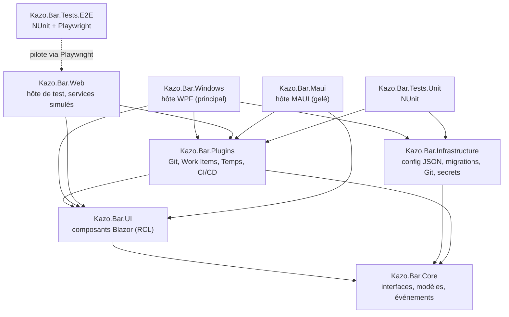

# Kazo Bar : backlog des fonctionnalités

Ce document est le **backlog** du projet : il décrit ce que la toolbar doit faire, et indique pour chaque user story ce qui est déjà fait. L'état actuel du logiciel, pour un nouvel utilisateur, est décrit dans le [README](../README.md) (en anglais).

Dernière revue complète contre le code : 6 novembre 2026 (branche `main`, après la PR #26). Toutes les US de la v1 sont implémentées ; restent la recette manuelle sur PC (🔍), l'intégration continue (US6.2, prévue en dernier) et les sessions d'agents GitHub (en attente d'une API publique).

## Comment lire ce document

**État d'une user story** (colonne « État » et ligne en tête de chaque US) :

| Symbole | Signification |
|---|---|
| ✅ Fait | Tous les critères d'acceptation sont remplis dans l'hôte WPF. |
| 🟡 Partiel | Une partie des critères est remplie ; les cases non cochées disent ce qui manque. |
| 🎭 Simulé | L'interface est faite, mais les données viennent d'un service simulé (mock), **y compris dans l'hôte WPF**. |
| ⬜ À faire | Rien n'est implémenté. |
| 🔍 À recetter | Implémenté, mais pas encore vérifié à la main sur un PC Windows. |
| 🧊 Gelé | Conservé, mais ne reçoit plus de nouvelles fonctions. |

**Critères d'acceptation** : `- [x]` = fait, `- [ ]` = pas fait.

## Vocabulaire

| Terme | Sens dans ce document |
|---|---|
| **Projet** | Un contexte de travail sélectionnable dans la toolbar (pilule de gauche). On le crée puis on l'associe à un dépôt et à son dossier local. Il porte aussi des actions et un thème. |
| **Dépôt** | Un dépôt Git configuré dans un projet. Chaque dépôt est **relié à un dossier local**. Les fournisseurs (work items, CI/CD, sessions d'agents) se configurent par dépôt. |
| **Hôte** | L'exécutable qui affiche l'interface Blazor : WPF (principal), Web (tests), MAUI (gelé). |
| **Plugin** | Un module qui ajoute un indicateur et un panneau à la toolbar (Git, Work Items, Temps, CI/CD). |
| **Pilule** | La forme arrondie de la toolbar et de ses groupes, voir la maquette. |
| **Configuration utilisateur** | Le fichier JSON unique de l'utilisateur, dans `%APPDATA%\Kazo\Bar`, qui contient tous les projets et dépôts. |

## Décisions prises

| Sujet | Décision | Date |
|---|---|---|
| Hôte Windows | WPF (`src/Kazo.Bar.Windows`) est la voie principale. MAUI est **gelé** : il reste dans la solution mais ne reçoit plus de nouvelles fonctions. | 2 et 3 nov. 2026 |
| Configuration | **Un seul fichier de configuration par utilisateur**, qui contient tous les projets et dépôts. Pas de niveaux Global / Type / Projet, pas de `template.json`. | 3 nov. 2026 |
| Données sensibles | Les jetons ne vont **pas** dans le JSON en clair. On offre **deux options** : le coffre du système (Gestionnaire d'identification Windows) ou un fichier chiffré localement. | 3 nov. 2026 |
| Authentification | On suit la méthode **recommandée par chaque fournisseur** (OAuth en général). Le PAT reste possible pour démarrer. | 3 nov. 2026 |
| Projet et dépôt | On crée un projet et on l'associe à un dépôt et à son dossier local. Le modèle permet plusieurs dépôts par projet, mais la gestion de plusieurs dépôts est un **ajout pour plus tard** : la priorité est le cas un projet = un dépôt. | 3 nov. 2026 |
| Stockage | Fichiers JSON dans `%APPDATA%\Kazo\Bar` pour l'instant. Chaque fichier porte une propriété de **version de schéma** et doit pouvoir être migré (vers un autre format ou une base plus tard). SQLite n'est plus requis. | 3 nov. 2026 |
| Work items | Configurables **par dépôt** : Azure DevOps (cloud) et GitHub Issues. Authentification par PAT pour commencer. | 3 nov. 2026 |
| Suivi GitHub (F7) | Configurable **par dépôt** : workflows GitHub Actions, sessions d'agents, ou les deux. | 3 nov. 2026 |
| Git | État lu dans le dossier local du dépôt avec **LibGit2Sharp** (pas de la configuration). | 3 nov. 2026 |
| Glisser-déposer des modules | Mode « ✏️ Réorganiser » depuis le clic droit : on glisse les modules dans leur zone ou d'une zone à l'autre, ✅ / ❎ remplacent le bouton Paramètres. Le dernier module (minuteur) ne bouge pas (US3.9). | 6 nov. 2026 |
| Débordement des modules | Les modules de la zone système qui ne tiennent plus passent dans un bouton « » » (US3.8). | 4 nov. 2026 |
| Maquette | `doc/Toolbar-desing-exemple.png` est une **ligne directrice** : les éléments restent les mêmes, les thèmes proposés à l'utilisateur changent le style. | 3 nov. 2026 |
| Fonctions de debug | Visibles uniquement dans une build `Debug` (`#if DEBUG` ou `IsDevelopment`). Seul le bouton 🧪 « Test Dropdown » est concerné. Les modes d'ancrage, l'écran cible, la hauteur, et les fenêtres actives sont des fonctions normales. | 3 nov. 2026 |
| Mode remplacement de la barre des tâches | **Retiré** : l'interrupteur ne faisait rien ; on garde seulement « Afficher les fenêtres actives ». | 4 nov. 2026 |
| Plugins tiers | Pas de chargement de DLL externes pour l'instant, mais le système de plugins doit rester ouvert pour que n'importe qui puisse en écrire un. | 3 nov. 2026 |
| Intégration continue | Pas maintenant ; obligatoire pour la version finale. | 3 nov. 2026 |
| Fermer la toolbar | Fermer la fenêtre **quitte l'application** (pas de réduction dans la zone de notification). | 3 nov. 2026 |

## Questions ouvertes

Les nouvelles questions s'ajoutent ici avec un numéro.

*(Aucune pour l'instant. La question n° 1, glisser-déposer et changement de zone, est réglée par US3.9.)*

## Vue d'ensemble

| US | Titre | État |
|---|---|---|
| US1.1 | Solution et projets | ✅ |
| US1.2 | Interfaces Core | ✅ |
| US2.1 | Système de plugins | ✅ |
| US2.2 | Changement de projet | ✅ |
| US2.3 | Configuration utilisateur unique | ✅ 🔍 |
| US2.4 | Stockage sécurisé des secrets | 🟡 🔍 |
| US2.5 | Version de schéma et migration | ✅ 🔍 |
| US3.1 | Layout principal (pilule) | ✅ |
| US3.2 | Couleur d'accent et police par projet | ✅ |
| US3.3 | Thèmes proposés à l'utilisateur | ✅ |
| US3.4 | Vue compacte et débordement | ✅ 🔍 |
| US3.5 | Fonctions de debug masquées en Release | ✅ |
| US3.6 | Modules redimensionnables | ✅ 🔍 |
| US3.7 | Ordre des modules | ✅ 🔍 |
| US3.8 | Débordement des modules et de leurs éléments | ✅ 🔍 |
| US3.9 | Réorganiser les modules par glisser-déposer | ✅ 🔍 |
| US3.10 | Page des paramètres d'un projet | ✅ 🔍 |
| US3.11 | Boîtes de dialogue dans leur propre fenêtre | ✅ 🔍 |
| US4.1 | Bouton « Lancer processus » | ✅ |
| US4.2 | Smart Focus | ✅ 🔍 |
| US4.3 | Bouton script et sortie terminal | ✅ 🔍 |
| US5.1 | Plugin Git | ✅ 🔍 |
| US5.2 | Plugin Work Items | 🟡 🔍 |
| US5.6 | Sélecteur de dépôt et worktrees Git | ✅ 🔍 |
| US5.3 | Suivi du temps et inactivité | ✅ 🔍 |
| US5.4 | Rapports de temps | ✅ 🔍 |
| US5.5 | Journée de travail (arrivée, dîner, réunion) | ✅ 🔍 |
| US6.1 | Tests Playwright sur l'hôte Web | ✅ |
| US6.2 | Intégration continue | ⬜ |
| US7.1 | Suivi GitHub en arrière-plan | 🟡 🔍 |
| US7.2 | Consultation et « marquer comme lu » | ✅ 🔍 |
| US8.1 | Fenêtre native | ✅ 🔍 |
| US8.2 | Zone de notification | ✅ 🔍 |
| US8.3 | Stockage local JSON | ✅ 🔍 |
| US8.4 | Position et ancrage de la toolbar | ✅ 🔍 |
| US8.5 | Fenêtres actives | ✅ 🔍 |
| US9.1 | Hôte WPF principal | ✅ 🔍 |
| US9.2 | Hôte MAUI gelé | 🧊 |
| US10.1 | Sessions et coûts IA (v2) | ⬜ v2 |
| US10.2 | Rapport des coûts IA (v2) | ⬜ v2 |

---

# F1. Architecture et fondations

## Projets de la solution



```text
Kazo.Bar.slnx
├── src
│   ├── Kazo.Bar.Core       Interfaces/, Models/, Events/, Layout/, Configuration/, Data/
│   ├── Kazo.Bar.Infrastructure  Storage/, Configuration/, Git/, Secrets/ (services réels, testés sous Linux)
│   ├── Kazo.Bar.UI         Components/, Layouts/, Pages/, Services/, wwwroot/
│   ├── Kazo.Bar.Plugins    Git/, WorkItems/, TimeTracker/, GithubAgents/, Services/PluginLoader.cs
│   ├── Kazo.Bar.Windows    Hôte WPF : ToolbarWindow.cs, Program.cs, Services/
│   ├── Kazo.Bar.Web        Hôte de test : Mocks/, Program.cs
│   └── Kazo.Bar.Maui       Hôte MAUI gelé
├── tests
│   ├── Kazo.Bar.Tests.E2E  Drivers/, Scenarios/
│   └── Kazo.Bar.Tests.Unit
└── spikes/window-feasibility Banc d'essai de la fenêtre transparente (historique)
```

Tous les projets ciblent **.NET 10**.

## US1.1 Solution et projets
**État :** ✅ Fait

**En tant que** développeur
**Je veux** une solution qui sépare la logique, l'interface et les hôtes natifs
**Afin de** réutiliser la même interface dans plusieurs hôtes et la tester dans un navigateur.

**Critères d'acceptation :**
- [x] La solution `Kazo.Bar.slnx` contient Core, Infrastructure, UI, Plugins, Windows, Web, Maui et les deux projets de tests.
- [x] `Kazo.Bar.UI` et `Kazo.Bar.Plugins` ne référencent que `Kazo.Bar.Core`.
- [x] Chaque hôte référence UI, Plugins et Core.
- [x] L'hôte Web démarre et affiche la toolbar sans erreur.

## US1.2 Interfaces Core
**État :** ✅ Fait

**En tant qu'** architecte
**Je veux** que tout accès natif (processus, fichiers, fenêtres, configuration, stockage) passe par une interface de `Kazo.Bar.Core`
**Afin d'** injecter des services réels dans l'hôte WPF et des services simulés dans l'hôte Web.

**Critères d'acceptation :**
- [x] Interfaces dans `src/Kazo.Bar.Core/Interfaces/` : `IProcessService`, `IFileSystemService`, `ISettingsService`, `IGlobalSettingsService`, `IScriptService`, `IStorageService`, `IPlugin`, `IPluginLoader`, `IWorkItemProvider`, `ITimeTrackingService`, `ICiCdService`, et les services de fenêtre (`IDockingService`, `IWindowService`, `IWindowDragService`, `IHostSurfaceService`, `IWindowRegionService`, `INativeService`).
- [x] L'hôte Web n'enregistre que des implémentations simulées (`src/Kazo.Bar.Web/Mocks/`).

```csharp
public interface IProcessService
{
    Task<int> StartProcessAsync(string path, string arguments = "");
    bool FocusWindowByTitle(string titleRegex);
}
```

---

# F2. Plugins et configuration

## US2.1 Système de plugins
**État :** ✅ Fait

**En tant que** développeur tiers
**Je veux** écrire mon propre plugin en implémentant `IPlugin`
**Afin d'** ajouter à la toolbar un outil adapté à mes besoins.

**Critères d'acceptation :**
- [x] `PluginLoader` (`src/Kazo.Bar.Plugins/Services/PluginLoader.cs`) liste les plugins enregistrés dans l'injection de dépendances.
- [x] Chaque plugin a un `UniqueId`, un `Name` et une icône.
- [x] Un plugin peut afficher un indicateur dans la pilule (`IPluginIndicator`) et une fenêtre de configuration (`IConfigurablePlugin`).
- [x] Un plugin déclare comment son module prend de la place avec `IPlugin.Layout` (`PluginLayout`) : fixe par défaut, ou `PluginLayout.ResizableWidth(défaut, min, max)` pour que l'utilisateur puisse changer sa largeur (US3.6).
- [x] Un guide « Écrire un plugin » ([Writing-a-plugin.md](Writing-a-plugin.md), en anglais) explique le contrat, où ranger les données et les secrets, et comment l'enregistrer. Son exemple est compilé et testé (`SamplePluginTests`).
- Hors périmètre pour l'instant : chargement de DLL externes depuis un dossier.

## US2.2 Changement de projet
**État :** ✅ Fait

**En tant qu'** utilisateur
**Je veux** que la toolbar change quand je sélectionne un autre projet
**Afin de** voir uniquement les outils utiles à ce projet.

**Critères d'acceptation :**
- [x] Le sélecteur de projet (pilule de gauche) liste les projets de la configuration.
- [x] Le changement de projet notifie tous les plugins (`OnProjectChangedAsync`) et met à jour les actions et le thème.
- [x] Seuls les plugins de `enabledPlugins` sont affichés.

## US2.3 Configuration utilisateur unique
**État :** ✅ Fait, 🔍 à recetter sur PC

**En tant qu'** utilisateur
**Je veux** que toute ma configuration (projets, dépôts, actions, thèmes, règles de temps) soit dans un seul fichier
**Afin de** savoir où elle se trouve et de pouvoir la sauvegarder facilement.

**Critères d'acceptation :**
- [x] La configuration est lue depuis `%APPDATA%\Kazo\Bar\config.json` (`UserConfigurationStore`, `src/Kazo.Bar.Infrastructure/Configuration/`).
- [x] Un seul fichier contient tout : `settings` (réglages globaux) et `projects`. L'ancien `global-settings.json` est fusionné au premier lancement puis déplacé dans `backups\`.
- [x] Les surcharges par `.devtoolbar.json` dans le dossier du projet sont **retirées** de l'hôte WPF (l'hôte MAUI gelé garde son ancien code).
- [x] Chaque dépôt déclare son dossier local (`localPath`).
- [x] Chaque dépôt déclare son fournisseur de work items (`workItems`) et son suivi GitHub (`github`), avec une `secretRef` seulement (US5.2 et US7.1).
- [x] Aucune donnée sensible n'est écrite dans ce fichier : les jetons vont dans le magasin de secrets (US2.4).
- [x] Paramètres affiche l'emplacement du fichier (section « Configuration »).

Forme actuelle (schéma 1). Les blocs `workItems` et `github` d'un dépôt sont lus par les fournisseurs, `timeTracking` par le suivi du temps (US5.3). Ajouter ces blocs optionnels ne change pas la version du schéma :

```json
{
  "schemaVersion": 1,
  "activeProjectId": "alpha",
  "settings": { "toolbarBehavior": 2, "targetMonitorIndex": 0, "toolbarHeight": 56, "secretStore": "CredentialManager", "ciPollingIntervalSeconds": 60 },
  "projects": [
    {
      "id": "alpha",
      "name": "Projet Alpha",
      "theme": { "name": "light", "accentColor": "#0078D7" },
      "enabledPlugins": ["git", "work-items", "time-tracker", "github-agents"],
      "actions": [],
      "repositories": [
        {
          "name": "alpha-api",
          "localPath": "C:\\repos\\alpha-api",
          "remoteUrl": "https://github.com/contoso/alpha-api.git",
          "defaultBranch": "main",
          "workItems": { "provider": "AzureDevOps", "organization": "contoso", "project": "Alpha", "secretRef": "alpha-devops-pat" },
          "github": { "repository": "contoso/alpha-api", "trackActions": true, "secretRef": "alpha-github-pat" },
          "timeTracking": { "idleMinutes": 10 }
        }
      ]
    }
  ]
}
```

## US2.4 Stockage sécurisé des secrets
**État :** 🟡 Partiel, 🔍 à recetter sur PC

**En tant qu'** utilisateur
**Je veux** que mes jetons d'accès soient stockés de façon chiffrée
**Afin qu'** une copie de mon fichier de configuration ne donne pas accès à mes comptes.

**Critères d'acceptation :**
- [x] Les secrets sont rangés sous une référence (`secretRef`) via `ISecretStore` ; la configuration ne garde que la référence. Les fournisseurs (US5.2, US7.1) proposent une référence par dépôt et par service.
- [x] L'utilisateur choisit où sont stockés ses secrets dans Paramètres (« Access tokens ») : Gestionnaire d'identification Windows (`Kazo.Bar:<ref>`), ou `%APPDATA%\Kazo\Bar\secrets.json` chiffré par DPAPI pour son compte Windows. Changer de choix déplace les secrets existants.
- [x] Chaque fournisseur utilise la méthode d'authentification qu'il recommande : « Sign in with GitHub » et « Sign in with Microsoft » (flux *device code* OAuth 2.0, RFC 8628) à côté du champ du jeton, dans les réglages des plugins Work Items et CI/CD. Le PAT reste possible. La connexion est rangée sous la même référence (`secretRef`), dans un petit objet JSON (`{"kind":"oauth", …}`) : le jeton d'accès GitHub (qui n'expire pas), ou le seul *refresh token* Microsoft. Le jeton d'accès Microsoft reste en mémoire et il est renouvelé deux minutes avant son expiration, ce qui garde la valeur sous la limite de 2 560 octets du Gestionnaire d'identification (`AccessTokenResolver`, `DeviceCodeSignInService`, `src/Kazo.Bar.Infrastructure/Auth/`).
- [x] Les applications OAuth se déclarent une fois dans Paramètres → *Sign-in apps* (`settings.oauth.github.clientId`, `settings.oauth.azureDevOps.clientId` et `tenant`). Un identifiant client est public, aucun secret client n'est demandé. La marche à suivre est dans [Connexion-OAuth.md](Connexion-OAuth.md).
- [ ] Recette sur PC : connexion réelle à GitHub et à Azure DevOps avec les applications déclarées.
- [x] Les jetons saisis dans les réglages des plugins ne sont jamais réaffichés : le champ (`SecretField`) affiche « ●●●●●●●● saved », ou « ✓ Signed in with GitHub / Microsoft » après une connexion, avec remplacer / supprimer.
- [ ] Recette sur PC : écriture, lecture et suppression dans le Gestionnaire d'identification et avec DPAPI (non testables dans le conteneur Linux).

## US2.5 Version de schéma et migration
**État :** ✅ Fait, 🔍 à recetter sur PC (migration d'une vraie configuration existante)

**En tant que** mainteneur
**Je veux** que chaque fichier de données porte sa version de schéma
**Afin de** faire évoluer le format sans perdre les données des utilisateurs.

**Critères d'acceptation :**
- [x] Chaque fichier JSON écrit par l'application contient `schemaVersion` (`config.json`, `secrets.json`, `data\*.json`).
- [x] Au chargement, un fichier d'ancienne version est migré puis réécrit ; une copie de l'original est conservée dans `%APPDATA%\Kazo\Bar\backups\` (`config.v0.<date>.json`). Les migrations travaillent sur l'arbre JSON (`IJsonMigration`, `VersionedJson`).
- [x] Un fichier illisible ou écrit par une version plus récente n'est jamais écrasé : l'application démarre sur des valeurs par défaut et le signale dans le journal.
- [x] L'accès aux données passe par `IStorageService`, pour pouvoir changer de format (base de données) plus tard.

---

# F3. Interface et thèmes

Référence visuelle : [`doc/Toolbar-desing-exemple.png`](Toolbar-desing-exemple.png). C'est une ligne directrice : la disposition et les éléments sont fixes, les thèmes en changent le style.

## US3.1 Layout principal (pilule)
**État :** ✅ Fait

**En tant qu'** utilisateur
**Je veux** une toolbar compacte en forme de pilule
**Afin d'** accéder à mes outils sans perdre de place à l'écran.

**Critères d'acceptation :**
- [x] De gauche à droite : projet et Git, actions rapides, puis groupe système (indicateurs des plugins, temps, rapports, paramètres).
- [x] `ProjectSelector`, `PluginZone`, `ActionDeck` et la poignée de déplacement sont des composants de `Kazo.Bar.UI`.
- [x] Les menus s'ouvrent sous la toolbar, ou au-dessus si elle est ancrée en bas.
- [x] Les menus se ferment par un clic extérieur, `Échap` (le focus revient au déclencheur) ou quand une autre application est activée.

## US3.2 Couleur d'accent et police par projet
**État :** ✅ Fait

**En tant qu'** utilisateur
**Je veux** que la couleur d'accent change selon le projet
**Afin de** savoir d'un coup d'œil dans quel contexte je suis.

**Critères d'acceptation :**
- [x] `ThemeService` génère les variables CSS `--accent-color` et `--font-family`.
- [x] Un CSS personnalisé dans la configuration du projet est injecté.
- [x] La couleur et la police se modifient dans Paramètres.

## US3.3 Thèmes proposés à l'utilisateur
**État :** ✅ Fait

**En tant qu'** utilisateur
**Je veux** choisir un thème (clair, sombre, vert…)
**Afin d'** adapter la toolbar à mon goût sans changer sa disposition.

**Critères d'acceptation :**
- [x] Les thèmes clair, sombre et vert de la maquette sont disponibles dans l'interface Blazor (`css/themes.css`, attribut `data-theme` sur la toolbar). Le clair est l'apparence de base ; le sombre et le vert changent le verre, les modules Git et système, les boutons d'action, la liste des projets et les panneaux des plugins.
- [x] Le thème se choisit dans Paramètres → *Theme*, comme la couleur d'accent et la police. Il est propre à chaque projet (`projects[].theme.name` : `light`, `dark` ou `green` ; un nom inconnu donne le clair) et il est enregistré dans la configuration. Changer de projet change donc aussi de thème.
- [x] Un thème ne change que les styles (couleurs, ombres, verre), jamais les éléments ni leurs tailles : un test E2E compare la liste des éléments de la toolbar avant et après le changement de thème.
- La page Paramètres et le rapport de temps gardent leur apparence sombre actuelle dans tous les thèmes.

## US3.4 Vue compacte et débordement
**État :** ✅ Fait, 🔍 à recetter sur PC

**En tant qu'** utilisateur avec peu de place
**Je veux** que les textes longs soient tronqués et que les actions en trop passent dans un menu « … »
**Afin que** la toolbar reste lisible.

**Critères d'acceptation :**
- [x] Le nom de projet (180 px) et la branche (160 px) sont tronqués avec « … » et affichés en entier dans l'info-bulle.
- [x] La toolbar n'est jamais plus large que la fenêtre (960 px dans l'hôte WPF). Quand les actions ne tiennent pas dans la place laissée par les autres zones, un bouton « … » ouvre un menu avec les actions masquées (`ActionDeck`, `ActionOverflow`, `action-overflow.js`). Le menu se ferme par un clic extérieur ou `Échap`, et s'ouvre vers le haut si la toolbar est ancrée en bas.

## US3.5 Fonctions de debug masquées en Release
**État :** ✅ Fait

**En tant qu'** utilisateur final
**Je veux** ne pas voir les outils de développement de la toolbar
**Afin d'** avoir une interface propre.

**Critères d'acceptation :**
- [x] Le bouton 🧪 « Test Dropdown » n'est rendu que si `Kazo.Bar.UI` est compilé en `Debug` (`DebugFeatures.Enabled`, basé sur `#if DEBUG`).
- [x] Toute future fonction de debug suit la même règle : tester `DebugFeatures.Enabled` au lieu d'écrire `#if DEBUG` dans chaque composant.

## US3.6 Modules redimensionnables
**État :** ✅ Fait, 🔍 à recetter sur PC

**En tant qu'** utilisateur dont les noms de dépôt ou de branche sont longs
**Je veux** élargir un module de la toolbar, et revenir à sa largeur d'origine
**Afin de** lire ce qui m'intéresse sans changer la taille des autres modules.

**Critères d'acceptation :**
- [x] Le comportement est le même pour tous les plugins : un plugin qui déclare `Resizable = true` (`IPlugin.Layout`, `PluginLayout.ResizableWidth`) a une poignée sur son bord droit. Le module Git est le premier à le déclarer (300 px par défaut, de 170 à 560 px).
- [x] On tire la poignée pour changer la largeur (bornée entre le minimum et le maximum du plugin) ; les flèches ⟵ ⟶ font la même chose au clavier quand la poignée a le focus.
- [x] La largeur est enregistrée par module dans la configuration utilisateur (`settings.toolbarLayout.moduleWidths`) et retrouvée au démarrage.
- [x] Un clic droit sur le module ouvre un petit menu avec « ↔ Reset width », qui remet la largeur par défaut du plugin. Paramètres → *Toolbar Modules* → « Reset widths » remet tous les modules.
- [x] Le menu se ferme par un clic extérieur ou `Échap`, et s'ouvre vers le haut si la toolbar est ancrée en bas.
- Composants : `ModuleFrame.razor`, `module-resize.js`, `ToolbarLayoutController`.

## US3.7 Ordre des modules
**État :** ✅ Fait, 🔍 à recetter sur PC

**En tant qu'** utilisateur
**Je veux** choisir l'ordre des modules de la toolbar
**Afin de** mettre à portée de main ceux que j'utilise le plus.

**Critères d'acceptation :**
- [x] La toolbar a des zones : le sélecteur de projet (toujours à gauche), la **zone principale** (module Git, actions rapides) et la **zone système** (indicateurs des plugins, minuteur). Les boutons Rapport, Paramètres et 🧪 restent toujours à droite.
- [x] Le clic droit sur un module propose « ◀ Move left » et « Move right ▶ », à l'intérieur de sa zone (jamais pour le minuteur, ni au-delà de lui : voir US3.9).
- [x] Paramètres → *Toolbar Modules* liste les modules de chaque zone dans l'ordre choisi, avec ▲ / ▼, et « Reset order » remet l'ordre par défaut.
- [x] L'ordre est enregistré dans `settings.toolbarLayout.moduleOrder` (un seul ordre pour tous les projets). Un module absent de la liste (nouveau plugin activé) se place à la fin de sa zone ; un id inconnu est ignoré (`ToolbarModuleOrder`).
- [x] Quand le module Git suit directement le projet, il passe sous la pilule du projet comme sur la maquette ; ailleurs, c'est une pilule à part entière.
- [x] *(Question ouverte n° 1, réglée le 6 nov. 2026)* Glisser-déposer dans la toolbar et changement de zone : voir US3.9.

## US3.9 Réorganiser les modules par glisser-déposer
**État :** ✅ Fait, 🔍 à recetter sur PC

**En tant qu'** utilisateur
**Je veux** déplacer les modules de la toolbar à la souris, dans leur zone ou d'une zone à l'autre
**Afin de** composer ma toolbar sans passer par les menus ni les Paramètres.

**Critères d'acceptation :**
- [x] Le clic droit sur un module propose « Réorganiser » (icône crayon), qui active le mode réorganisation. Les modules sont alors encadrés en pointillé ; leur contenu ne réagit plus aux clics, et on les glisse en entier.
- [x] Pendant ce mode, les boutons ✅ (garder) et ❎ (annuler), en icônes Font Awesome, remplacent le bouton ⚙️ Paramètres. ✅ enregistre le nouvel ordre ; ❎ ou `Échap` remet la toolbar comme avant. Rien n'est enregistré avant ✅.
- [x] Déposé sur un module de la même zone, un module prend sa place (comme une liste triable). Déposé sur un module d'une autre zone, il se place devant lui. Un trait de couleur montre où il va tomber.
- [x] Un module peut changer de zone (par exemple Git dans la zone système). Une case pointillée au bout de la zone principale permet d'y ajouter un module à la fin, même si la zone est vide.
- [x] Le seul module qui ne peut pas être déplacé est le **dernier**, le minuteur : il reste toujours à la fin de la zone système, à côté des boutons, et rien ne peut être déposé après lui. « Move left / right » et ▲ / ▼ dans les Paramètres le respectent aussi.
- [x] La pilule du projet et le module Git, collés à gauche, ne bougent pas non plus (voir US5.6). La zone principale contient donc les actions rapides et les modules qu'on y dépose.
- [x] Pendant le mode, aucun module ne part dans le menu « » » (US3.8), pour qu'on puisse tous les déplacer.
- [x] La zone de chaque module est enregistrée dans `settings.toolbarLayout.moduleZones` (id → `main` ou `system`), à côté de `moduleOrder`. Une zone inconnue est ignorée ; « Reset order » remet aussi les zones par défaut. Pas de changement de version de schéma : la propriété est facultative.
- Capture : `doc/screenshots/19-reorganize-mode.png`.
- Composants : `ModuleFrame.razor` (glisser, menu), `MainLayout.razor` (zones, ✅ / ❎), `ToolbarLayoutController` (brouillon, enregistrement), `ToolbarModuleLayout` et `ToolbarArrangement` (logique pure, testée).

## US3.10 Page des paramètres d'un projet
**État :** ✅ Fait, 🔍 à recetter sur PC

**En tant qu'** utilisateur
**Je veux** une page pour changer les paramètres d'un projet (couleur, nom affiché, etc.)
**Afin de** ne pas modifier `config.json` à la main.

**Critères d'acceptation :**
- [x] *(Demandé par Benoit le 7 nov. 2026)* La page `/project-settings/{id}` modifie le **nom affiché**, le type, le **dossier local** (*Browse…*), la branche par défaut, l'URL du dépôt, le **thème**, la **couleur d'accent** (sélecteur ou code `#RRGGBB`), la police et le CSS personnalisé. Un aperçu de la pilule montre le nom et la couleur.
- [x] On l'ouvre depuis Paramètres (« ✏️ Edit project… » sur le projet actif, ✏️ sur chaque ligne de *All Projects*) ou depuis le menu de la pilule du projet (« Project settings… »).
- [x] Les changements sont un **brouillon** : rien n'est enregistré avant « Save » ; « Cancel » les abandonne. Les champs invalides (nom vide, couleur, nom de branche, URL non http(s), CSS qui ferme la balise `style`) affichent leur erreur et rien n'est enregistré.
- [x] Enregistrer le projet actif l'applique tout de suite à la toolbar (nom, thème, couleur, dossier pour le plugin Git). Si le dossier change, le dépôt qui pointait vers l'ancien dossier le suit.
- [x] « Remove project… » retire le projet de Kazo Bar après confirmation (le dossier et le dépôt ne sont pas touchés). Le dernier projet ne peut pas être retiré ; si le projet retiré était actif, le premier projet restant devient actif.
- La gestion des worktrees et des branches a sa propre demande ; les plugins et les actions rapides restent dans Paramètres.
- Ouvert dans sa propre fenêtre (une par projet) dans l'hôte WPF (US3.11) depuis le menu de la pilule et les Paramètres ; ailleurs, la page `/project-settings/{id}` affiche le même composant (`ProjectSettingsForm`, `ProjectId`, `OnSaved`, `OnClose`).
- Capture : `doc/screenshots/20-project-settings.png`.
- Logique : `ProjectSettingsDraft` (validation et projet à enregistrer, pure, testée), `ISettingsService.RemoveProjectAsync`.

## US3.8 Débordement des modules et de leurs éléments
**État :** ✅ Fait, 🔍 à recetter sur PC

**En tant qu'** utilisateur avec peu de place (fenêtre WPF de 960 px, petit écran)
**Je veux** que la toolbar reste lisible quand tout ne tient pas
**Afin de** ne jamais perdre l'accès à un module.

**Règles, dans l'ordre où elles s'appliquent :**
- [x] 1. Les textes longs sont tronqués avec « … » et affichés en entier dans l'info-bulle (projet, dépôt, branche, worktree, message de synchro).
- [x] 2. Les actions rapides en trop passent dans le menu « … » (US3.4).
- [x] 3. Les modules redimensionnables rétrécissent jusqu'à leur largeur minimale.
- [x] 4. **Éléments dans un module** : un module redimensionnable est un conteneur CSS (`container-name: module`). Il cache d'abord ses libellés, puis ses compteurs et messages, selon sa largeur (`@container module (max-width: …)`). Module Git : sous 240 px, Pull/Push n'affichent que leur icône et l'état « Clean / modified » seulement son symbole ; sous 190 px, l'avance/retard et le message de synchro disparaissent (toujours visibles dans les info-bulles). Un plugin tiers suit la même règle dans sa propre feuille de style.
- [x] 5. *(Choisi par Benoit le 4 nov. 2026)* Si ça ne tient toujours pas, les derniers modules de la zone système passent dans un bouton « » » placé avant les boutons Rapport et Paramètres. L'ordre de US3.7 décide qui part en premier (le plus à droite). Le menu liste chaque module masqué (icône, texte de l'indicateur, badge, couleur d'état) ; un clic ouvre son panneau à la place de la liste (« ← » pour revenir). Le bouton porte le total des badges masqués. Quand la place revient, les modules reviennent dans la toolbar. Calcul : `module-overflow.js` mesure la place qu'auraient les modules si les autres zones étaient au plus petit (actions réduites à « … », modules redimensionnables à leur minimum) ; `ModuleOverflow.VisibleCount` décide combien restent. Un module masqué reste rendu, invisible et hors du flux, pour pouvoir être mesuré.

## US3.11 Boîtes de dialogue dans leur propre fenêtre
**État :** ✅ Fait, 🔍 à recetter sur PC

**En tant qu'** utilisateur
**Je veux** que les écrans plus grands que la toolbar (Paramètres, Rapport de temps, Git...) s'ouvrent dans une vraie fenêtre
**Afin de** les déplacer, les redimensionner et les garder ouverts à côté de la toolbar.

**Critères d'acceptation :**
- [x] *(Demandé par Benoit le 7 nov. 2026)* N'importe quel composant Razor peut s'ouvrir dans une fenêtre séparée avec `IDialogService.OpenAsync` (paramètres du composant, titre, taille). Dans l'hôte WPF, c'est une fenêtre Windows normale (barre de titre, redimensionnable, bouton dans la barre des tâches).
- [x] Toutes les fenêtres partagent les mêmes services (même instance des paramètres, de Git, du suivi du temps...) : un changement fait dans une fenêtre se voit tout de suite dans les autres, comme deux onglets d'une application Blazor Server.
- [x] Les fenêtres s'échangent des messages par l'`EventAggregator` partagé (publier / s'abonner, sûr entre threads), et une boîte de dialogue peut renvoyer un résultat à celui qui l'a ouverte.
- [x] Une seule fenêtre par clé : rouvrir les Paramètres ramène la fenêtre déjà ouverte au premier plan. Une clé différente permet une fenêtre par dépôt.
- [x] Les **Paramètres** (bouton ⚙️ et menu de la zone de notification), les **paramètres d'un projet** (US3.10, une fenêtre par projet) et le **Rapport de temps** (📊) s'ouvrent dans leur fenêtre. La toolbar ne grandit plus pour les afficher.
- [x] Les hôtes sans fenêtres (hôte Web de test, MAUI gelé) affichent la boîte de dialogue par-dessus la page, ou vont à la page `/settings` pour les Paramètres.
- Guide développeur : [Dialogs.md](Dialogs.md). Composants : `WpfDialogService`, `DialogWindow` (WPF), `DialogWindowRoot`, `InPageDialogService`, `DialogOutlet`, `KnownDialogs` (UI).

---

# F4. Actions rapides

## US4.1 Bouton « Lancer processus »
**État :** ✅ Fait

**En tant que** développeur
**Je veux** un bouton qui lance un programme (Postman, Visual Studio…)
**Afin de** gagner du temps.

**Critères d'acceptation :**
- [x] Configuration : icône, libellé, chemin, arguments.
- [x] Lancement via `IProcessService.StartProcessAsync`.
- [x] Notification d'erreur si le chemin est invalide.

## US4.2 Smart Focus
**État :** ✅ Fait, 🔍 à recetter sur PC

**En tant qu'** utilisateur
**Je veux** qu'un bouton active la fenêtre de l'application si elle est déjà ouverte, et la lance sinon
**Afin de** ne pas ouvrir dix fois la même application.

**Critères d'acceptation :**
- [x] Configuration : expression régulière sur le titre de la fenêtre (`windowTitleRegex`).
- [x] Fenêtre trouvée : elle passe au premier plan. Sinon : le programme est lancé.
- [x] Plusieurs fenêtres trouvées : un menu liste leurs titres (et le processus) pour choisir laquelle activer, ou « Launch a new one ». `Esc` ou un clic à l'extérieur le ferme.
- [x] Toutes les fenêtres visibles de premier niveau sont parcourues (pas seulement la fenêtre principale de chaque processus) ; une fenêtre réduite est restaurée avant d'être activée.

## US4.3 Bouton script et sortie terminal
**État :** ✅ Fait, 🔍 à recetter sur PC

**En tant que** DevOps
**Je veux** lancer un script et voir sa sortie
**Afin de** vérifier qu'il a réussi.

**Critères d'acceptation :**
- [x] Choix de l'interpréteur (`pwsh`, `cmd`, `python`).
- [x] Une fenêtre « Terminal Output » affiche la sortie et le code de retour.
- [x] La sortie s'affiche **ligne par ligne pendant l'exécution** (`ProcessScriptService`) ; les lignes d'erreur (stderr) sont en rouge.
- [x] Un bouton « Stop » arrête le script et ses processus enfants ; fermer la fenêtre pendant l'exécution l'arrête aussi.

---

# F5. Plugins fournis

## US5.1 Plugin Git
**État :** ✅ Fait, 🔍 à recetter sur PC

**En tant que** développeur
**Je veux** voir la branche courante et l'état de mes dépôts
**Afin de** ne pas commiter dans la mauvaise branche.

**Critères d'acceptation :**
- [x] À la création d'un projet (Paramètres, « ＋ New project »), on l'associe à un dépôt et à son dossier local (cas principal).
- [x] *(Ajout pour plus tard, déjà amorcé par la PR #4)* Un projet peut contenir plusieurs dépôts ; on en sélectionne un dans le panneau Git.
- [x] Boutons Pull et Push sur le dépôt sélectionné (CLI `git`).
- [x] Les dépôts se gèrent dans la fenêtre de configuration du plugin.
- [x] Chaque dépôt est relié à un dossier local, choisi à la configuration (bouton « Browse… » / 📂, boîte de dialogue Windows).
- [x] La branche, le nombre de fichiers modifiés et l'avance/retard sur la branche suivie sont **lus dans le dossier local** avec LibGit2Sharp (`GitService`), relus toutes les 10 secondes. Dossier absent ou non Git : la toolbar l'indique.
- [x] Pull et Push (CLI `git`, sans invite de mot de passe, délai de 2 minutes) affichent leur résultat réel (succès, conflit, erreur de Git).

## US5.6 Sélecteur de dépôt et worktrees Git
**État :** ✅ Fait, 🔍 à recetter sur PC

**En tant que** développeur qui travaille dans plusieurs dépôts ou worktrees
**Je veux** un seul sélecteur (la pilule du projet), qui me montre d'abord le dépôt, puis la branche et le worktree courant
**Afin de** savoir tout de suite où je travaille et changer de dossier en un clic.

**Critères d'acceptation :**
- [x] Le module Git n'a plus de liste déroulante « 📁 » séparée : le module lui-même est le sélecteur. Un clic ouvre un menu avec les dépôts du projet (nom et dossier), le dépôt actif coché.
- [x] Dans le même menu, sous chaque dépôt qui a des worktrees, chaque worktree est un petit lien (nom du dossier · branche, « (main) » pour le dossier principal). Un clic sur le lien fait travailler le module dans ce worktree : état, Pull et Push s'exécutent dans son dossier.
- [x] Affichage du module, dans l'ordre : le **nom du dépôt** en premier (gras), puis plus petit la **branche** (⎇) et, si le dépôt a des worktrees, le **worktree courant** (🌿). L'état (✓ Clean / ● n modified, ⚠ si le dossier est absent) suit le nom du dépôt ; ↑/↓ suit la branche.
- [x] La liste des worktrees vient de `git worktree list --porcelain` (`GitService.GetWorktreesAsync`, `GitWorktreeParser`), relue à l'ouverture du menu. Un dépôt nu (bare) n'apparaît pas comme worktree. Sans Git ou hors dépôt : aucun worktree, le reste fonctionne.
- [x] Le module se redimensionne (US3.6) quand les noms sont trop longs ; clic droit pour revenir à la largeur par défaut.
- [x] *(Demandé par Benoit le 6 nov. 2026)* Comme sur la maquette, la pilule bleue du projet et le module Git forment **un seul bloc, toujours à gauche** (ni l'un ni l'autre ne se déplace, US3.9). La **pilule bleue** affiche le dépôt et son état, puis la branche et le worktree (contrat `IProjectPillContent`, composant `GitPillInfo`) ; c'est elle qui se redimensionne. Son menu liste les projets, puis les dépôts et leurs worktrees (`GitRepositoryMenu`). Le nom du projet reste dans l'info-bulle et dans le menu.
- [x] Le **module Git** ne garde que les boutons : ⬇ Pull, ⬆ Push et un bouton icône seule « Pull & Push » (`GitPlugin.PullAndPushAsync` : Pull puis Push ; le Push n'est pas lancé si le Pull échoue ou laisse des conflits).
- [x] Les icônes viennent de **Font Awesome Free 7.3.1** (SVG intégrés hors ligne, licence CC BY 4.0) : composant `FaIcon`, liste `FaIcons.cs`. Seules les icônes utilisées sont intégrées. Les emojis restants de la toolbar pourront suivre.
- [x] L'hôte Web simule deux worktrees pour le premier dépôt de chaque projet (tests et captures).

## US5.2 Plugin Work Items
**État :** 🟡 Partiel, 🔍 à recetter sur PC (réel dans l'hôte WPF, simulé dans l'hôte Web)

**En tant que** développeur
**Je veux** voir le ticket sur lequel je travaille et en changer
**Afin d'** imputer mon temps au bon ticket.

**Critères d'acceptation :**
- [x] Affichage « #ID - Titre », recherche et sélection d'un autre ticket.
- [x] Interface `IWorkItemProvider` commune aux fournisseurs.
- [x] Fournisseur **Azure DevOps (cloud)** : requête WIQL (tickets ouverts qui me sont assignés, ou recherche par titre / numéro), API REST 7.1 (`AzureDevOpsWorkItemsClient`).
- [x] Fournisseur **GitHub Issues** : tickets ouverts récents, recherche par titre / numéro, les PR sont exclues (`GitHubIssuesClient`).
- [x] PAT pour démarrer, rangé dans le magasin de secrets (US2.4). Erreurs lisibles (jeton refusé, projet introuvable) affichées dans le plugin.
- [x] Authentification recommandée par le fournisseur (OAuth, voir US2.4) : connexion Microsoft Entra pour Azure DevOps (jeton *Bearer*), connexion GitHub pour GitHub Issues.
- [x] Le fournisseur se configure **par dépôt** dans la fenêtre de configuration du plugin Work Items (le premier dépôt configuré du projet est utilisé).
- [x] Lien cliquable vers le ticket sur le web.
- [ ] Recette sur PC avec un vrai PAT Azure DevOps et GitHub.

## US5.3 Suivi du temps et inactivité
**État :** ✅ Réel dans l'hôte WPF (`TimeTrackingService`, `src/Kazo.Bar.Infrastructure/TimeTracking/`), 🔍 à recetter sur PC. L'hôte Web garde un service simulé avec une journée d'exemple.

**En tant qu'** employé ou travailleur autonome
**Je veux** que le temps soit suivi automatiquement et que mes absences soient détectées
**Afin d'** avoir des feuilles de temps exactes.

**Critères d'acceptation :**
- [x] Démarrer / arrêter le timer, total du jour affiché dans la pilule.
- [x] Le temps est rattaché au projet et au ticket actif.
- [x] Le verrouillage de session Windows (`SystemEvents.SessionSwitch`), la mise en veille et l'inactivité clavier/souris dans toutes les applications (`GetLastInputInfo`) sont détectés (`WindowsUserPresenceService`). Le timer est figé à la dernière saisie, puis repart au retour sur le même projet et le même ticket.
- [x] Le délai d'inactivité est configurable **globalement** et **par dépôt** (le réglage du dépôt l'emporte). Défaut : 15 minutes. Paramètres → « Time tracking ». Le verrouillage peut aussi ne pas figer le timer (`pauseOnLock`).
- [x] Au retour, un message indique la durée de l'absence, un badge apparaît sur le timer et le panneau ⏱ permet de la qualifier : réunion, dîner, « je travaillais », autre (texte libre), ou à retirer. Les absences de moins d'une minute sont ignorées.
- [x] Les entrées sont enregistrées localement (voir US8.3). Après un plantage ou un redémarrage, l'entrée ouverte est fermée au dernier signe de vie de l'application (enregistré chaque minute) et le trou devient une absence à qualifier.
- Temps compté comme travail : timer, réunion, « je travaillais », autre. Non compté : dîner, retiré, et une absence pas encore qualifiée.

## US5.4 Rapports de temps
**État :** ✅ Réel dans l'hôte WPF, 🔍 à recetter sur PC

**En tant qu'** utilisateur
**Je veux** consulter le temps passé par projet et par ticket
**Afin de** remplir mes feuilles de temps ou facturer.

**Critères d'acceptation :**
- [x] Fenêtre de rapport ouverte depuis le groupe système.
- [x] Période : aujourd'hui, 7 derniers jours, 30 derniers jours.
- [x] Regroupement par projet, ticket, jour ou description.
- [x] Export CSV.
- [x] Les absences qualifiées (réunion, dîner) apparaissent dans le rapport : les absences comptées sont des lignes du rapport et de l'export, et la section « Work days » donne pour chaque jour l'arrivée, le dernier verrouillage et toutes les absences.

## US5.5 Journée de travail (arrivée, dîner, réunion)
**État :** ✅ Fait dans l'hôte WPF, 🔍 à recetter sur PC

**En tant qu'** employé
**Je veux** voir à quelle heure j'ai ouvert ma session le matin et à quelle heure je l'ai verrouillée le soir, et que le dîner et ma réunion quotidienne soient reconnus automatiquement
**Afin de** remplir ma feuille de temps sans tout ressaisir.

**Critères d'acceptation :**
- [x] L'heure de première ouverture de session et l'heure du dernier verrouillage de la journée sont enregistrées et affichées (panneau ⏱ et rapport). Première activité : démarrage de l'application, déverrouillage ou première saisie du jour. Dernier verrouillage : dernier verrouillage ou fermeture de la toolbar. Une absence qui passe minuit termine la journée et commence la suivante, elle n'est pas comptée comme absence.
- [x] Une absence qui couvre au moins 30 minutes (`minimumMinutes`) de la plage **12 h à 13 h** est comptée automatiquement comme dîner pour la partie dans la plage ; le reste est à qualifier.
- [x] L'utilisateur peut indiquer qu'il a travaillé pendant le dîner (bouton « I worked through lunch ») ; le temps est alors compté comme travaillé.
- [x] Une réunion quotidienne récurrente se configure (nom, heures, jours ; défaut 11 h 45 à 12 h du lundi au vendredi, désactivée). Exemple : une absence de 11 h 45 à 13 h devient réunion (11 h 45 à 12 h) puis dîner (12 h à 13 h). Les segments automatiques restent à confirmer d'un clic.
- [x] Les plages du dîner et de la réunion se configurent globalement (Paramètres) et par dépôt (bloc `timeTracking` du dépôt dans `config.json` ; le délai d'inactivité du dépôt se règle aussi dans Paramètres).

Règles dans `config.json` (ajout compatible avec le schéma 1, les valeurs absentes prennent les défauts) :

```json
"settings": {
  "timeTracking": {
    "idleMinutes": 15,
    "pauseOnLock": true,
    "lunch": { "enabled": true, "start": "12:00", "end": "13:00", "minimumMinutes": 30 },
    "dailyMeeting": { "enabled": true, "label": "Daily", "start": "11:45", "end": "12:00", "days": [1, 2, 3, 4, 5] }
  }
},
"repositories": [ { "name": "alpha-api", "timeTracking": { "idleMinutes": 10, "lunch": { "start": "11:30", "end": "12:30" } } } ]
```

---

# F6. Tests et qualité

## US6.1 Tests Playwright sur l'hôte Web
**État :** ✅ Fait

**En tant que** développeur
**Je veux** tester l'interface de la toolbar dans un navigateur
**Afin de** valider l'interface sans lancer Windows.

**Critères d'acceptation :**
- [x] `Kazo.Bar.Web` utilise uniquement des services simulés (aucun processus réel n'est lancé).
- [x] `Kazo.Bar.Tests.E2E` démarre l'hôte Web et vérifie chaque US visible (`FeatureSpecTests`, `ToolbarUiTests`, `PluginSettingsTests`).
- [x] `ScreenshotTests` régénère les captures de `doc/screenshots/`.
- [x] `Kazo.Bar.Tests.Unit` couvre le plugin Git, la négociation de taille de l'hôte, la configuration et ses migrations, le stockage JSON, Git réel (dépôts temporaires) les secrets, et les fournisseurs (réponses HTTP simulées).

## US6.2 Intégration continue
**État :** ⬜ À faire, obligatoire pour la version finale

**Critères d'acceptation :**
- [ ] Un workflow GitHub Actions compile la solution et lance les tests unitaires et Playwright à chaque PR.

---

# F7. Suivi GitHub : Actions et sessions d'agents

Le suivi se configure **par dépôt** : workflows GitHub Actions, sessions d'agents, ou les deux.

## US7.1 Suivi en arrière-plan
**État :** 🟡 Partiel, 🔍 à recetter sur PC (Actions réel dans l'hôte WPF, simulé dans l'hôte Web)

**En tant que** développeur
**Je veux** que la toolbar interroge GitHub pour mes dépôts
**Afin de** savoir quand un build ou une session d'agent est terminé sans garder la page ouverte.

**Critères d'acceptation :**
- [x] Icône d'état global (en cours, succès, échec) dans la pilule.
- [x] Badge du nombre de résultats terminés non lus.
- [x] Interrogation réelle de l'API REST GitHub en arrière-plan (`GitHubActionsService`, sans Octokit), toutes les `ciPollingIntervalSeconds` (60 s par défaut, 30 s minimum ; réglable dans Paramètres → *Toolbar Behavior* → « GitHub polling interval », pris en compte au prochain démarrage ou changement de projet).
- [x] Suivi des workflows Actions activable par dépôt (fenêtre de configuration du plugin GitHub).
- [ ] Sessions d'agents : en attente d'une API GitHub publique pour les lister.

## US7.2 Consultation et « marquer comme lu »
**État :** ✅ Fait, 🔍 à recetter sur PC

**Critères d'acceptation :**
- [x] Un clic sur l'icône ouvre la liste des dernières exécutions.
- [x] Un clic sur une exécution l'ouvre dans le navigateur et la marque comme lue.
- [x] L'état « lu » est enregistré localement par projet (`data/github-actions.json`, voir US8.3). Au premier lancement, les exécutions déjà terminées sont considérées comme lues.

---

# F8. Intégration au bureau Windows

## US8.1 Fenêtre native
**État :** ✅ Fait dans l'hôte WPF, 🔍 à recetter sur PC

**Critères d'acceptation :**
- [x] Fenêtre sans bordure ni barre de titre, toujours au premier plan.
- [x] Fond transparent : les zones vides autour de la pilule laissent passer les clics et la molette vers l'application en dessous (aucune ombre extérieure, voir `src/Kazo.Bar.Windows/wwwroot/css/wpf-host.css`).
- [ ] Recette sur PC : clic au travers, vraie molette, premier clic extérieur avec un menu ouvert, DPI et plusieurs écrans.

## US8.2 Zone de notification
**État :** ✅ Fait dans l'hôte WPF, 🔍 à recetter sur PC

**Critères d'acceptation :**
- [x] Icône dans la zone de notification.
- [x] Clic gauche : afficher ou masquer la toolbar.
- [x] Clic droit : Masquer/Afficher, Paramètres, Quitter.
- [x] Fermer la fenêtre de la toolbar quitte l'application.

## US8.3 Stockage local JSON
**État :** ✅ Fait, 🔍 à recetter sur PC

**Critères d'acceptation :**
- [x] Configuration et paramètres en JSON dans `%APPDATA%\Kazo\Bar`.
- [x] Entrées de temps et absences qualifiées en JSON dans le même dossier, avec `schemaVersion` (voir US2.5) : un fichier par mois `data\time-yyyy-MM.json`, une valeur par jour (`yyyy-MM-dd` : arrivée, dernier verrouillage, entrées, absences), et `data\time-tracking.json` pour le dernier signe de vie.
- [x] États « lu » du suivi GitHub : `data\github-actions.json` (voir US7.2).
- [x] L'interface `IStorageService` a une implémentation réelle : `JsonStorageService`, un fichier `%APPDATA%\Kazo\Bar\data\<espace>.json` par espace de noms. (La migration SQLite de `Kazo.Bar.Core/Data` reste inutilisée.)

## US8.4 Position et ancrage de la toolbar
**État :** ✅ Fait dans l'hôte WPF, 🔍 à recetter sur PC

**Critères d'acceptation :**
- [x] Modes dans Paramètres (fonctions normales, pas de debug) : ancrée en haut, ancrée en bas (réserve la place comme une barre Windows), flottante, superposée (`Overlay`, en haut sans réserver de place).
- [x] Choix de l'écran cible.
- [x] Poignée à droite de la pilule pour déplacer la toolbar flottante ; elle reste à l'écran.
- [x] L'hôte et Blazor négocient la taille de la fenêtre pour que menus et Paramètres tiennent (`SurfaceSizeNegotiator`).

## US8.5 Fenêtres actives
**État :** ✅ Fait, 🔍 à recetter sur PC

**En tant qu'** utilisateur
**Je veux** voir mes fenêtres ouvertes dans la toolbar
**Afin de** passer d'une fenêtre à l'autre sans quitter la toolbar.

**Critères d'acceptation :**
- [x] Réglage « Afficher les fenêtres actives » : un bouton par fenêtre ouverte (icône et titre) ; un clic active la fenêtre.
- Le « Mode remplacement de la barre des tâches » est retiré (décision du 4 nov. 2026) : la barre des tâches Windows n'est pas modifiée. Une ancienne valeur `taskbarReplacementMode` dans `config.json` est ignorée.

---

# F9. Hôtes

## US9.1 Hôte WPF principal
**État :** ✅ Fait, 🔍 à recetter sur PC

- [x] `src/Kazo.Bar.Windows` : fenêtre WPF transparente (`AllowsTransparency`), `BlazorWebView` WPF officiel 10.0.110, pour la toolbar ; les boîtes de dialogue ont leur propre fenêtre opaque (US3.11).
- [x] Routes `/` (toolbar) et `/settings`.
- [x] Services Windows réels pour processus, fichiers, scripts, fenêtres, configuration.
- Historique et preuves du choix : [`spikes/window-feasibility/INTEGRATION.md`](../spikes/window-feasibility/INTEGRATION.md).

## US9.2 Hôte MAUI gelé
**État :** 🧊 Gelé

`src/Kazo.Bar.Maui` reste dans la solution mais ne reçoit plus de nouvelles fonctions. Il n'est pas compilé dans le conteneur Linux et n'est pas recetté.

---

# F10. Suivi des sessions et des coûts IA (v2)

Prévu pour la **v2**, pas avant. Objectif : voir dans la toolbar les sessions des assistants IA (GitHub Copilot, Claude d'Anthropic, OpenAI) et ce qu'elles coûtent, par projet si possible.

**Sources de données possibles** (à revérifier au moment de l'implémentation, ces API évoluent vite) :

| Fournisseur | Ce qui est disponible | Limites connues |
|---|---|---|
| Anthropic (Claude) | API Admin : rapports d'usage (jetons) et de coûts de l'organisation, filtrables par clé d'API et par modèle. Claude Code garde aussi en local un journal de chaque session avec les jetons consommés. | L'API Admin demande une clé admin d'organisation. Le journal local ne donne pas le prix ; il faut l'appliquer au tarif du modèle. |
| OpenAI | API Usage et API Costs de l'organisation (jetons et montants par jour, par projet, par clé). | Clé admin d'organisation requise. |
| GitHub Copilot | API de métriques Copilot (usage agrégé de l'organisation) et API de facturation (requêtes premium). Les sessions de l'agent Copilot apparaissent comme des PR et des tâches sur le dépôt. | Données surtout agrégées par organisation ou par jour, pas toujours par session. Peu de détail pour un abonnement individuel. |

## US10.1 Sessions et coûts IA dans la toolbar
**État :** ⬜ À faire (v2)

**En tant que** développeur
**Je veux** voir les sessions IA en cours ou récentes et leur coût du jour et du mois
**Afin de** surveiller ma consommation et ne pas dépasser mon budget.

**Critères d'acceptation :**
- [ ] Un plugin « IA » affiche dans la pilule le coût du jour (ou du mois) et un badge quand une session se termine.
- [ ] Les fournisseurs se configurent un par un (Copilot, Anthropic, OpenAI), avec leurs clés stockées comme les autres secrets (voir US2.4).
- [ ] Les sessions sont rattachées au projet ou au dépôt quand la source le permet (clé d'API par projet, dépôt de la PR, dossier de la session Claude Code).
- [ ] Un seuil de budget optionnel déclenche une notification.

## US10.2 Rapport des coûts IA
**État :** ⬜ À faire (v2)

**Critères d'acceptation :**
- [ ] Rapport par période (jour, semaine, mois), regroupé par fournisseur, modèle et projet.
- [ ] Export CSV, comme le rapport de temps (US5.4).
